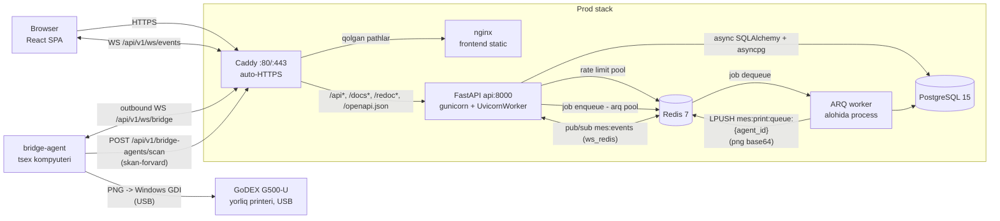

# MebeliX MES — Arxitektura Overview

## 1. Loyiha nima?

**MebeliX MES** — mebel ishlab chiqarishni boshqarish tizimi (Manufacturing Execution
System) uchun to'liq ishlaydigan fullstack ilova. FastAPI fullstack template
poydevorida (JWT + httpOnly cookie auth, users boshqaruvi) **to'liq MES domeni**
qurilgan: `/v1` agregatorida **26 ta router** (health, login, public, logout, users,
clients, employees, machines, posts, orders, pachka, tmo, catalog, audit,
terminal, terminal-devices, downtimes, defects, defects-review, scans, settings, tablo,
reports, system, bridge-agents, ws), **27 ta ORM model**
(Order/Product/Part/PartInstance/PartRoute/OrderFile/WasteItem, Client, Employee,
Machine, Post, Organization, Pachka/PachkaItem, Scan/WorkSession, AuditLog,
BridgeAgent, TerminalDevice, User, CatalogItem, PartDefect, Downtime/DowntimeReason, AndonEvent,
KromkaMeasurement, SystemSetting) va **16 ta `UserRole`** (admin, director, manager,
texnolog, terminal, tablo, skladchi + 9 ta post operatori roli: arrachi, kromkachi, ovalchi,
prisadkachi, roverchi, stolyar, boyoqchi, upakovkachi, omborchi).
Material katalogi (`materials` routeri, `Material` modeli, `MaterialType`
enumi) olib tashlangan, uning `material` jadvali ham `d2b71f4c86e9` migratsiyasi
bilan o'chirilgan. Materiallar ombori (`stock` routeri, `StockItem`/`Sale`/`Payment`/
`StockMove` modellari, `material_omborchi` roli) ham olib tashlangan — lekin uning
jadvallari (`stock_item`, `sale`, `payment`, `stock_move`) va migratsiyalari bazada
qolgan (`LEGACY_TABLES`), kod ularga tegmaydi.
Domen tafsilotlari uchun [09-mes-domain.md](./09-mes-domain.md) ga qarang.

Barcha UI matnlari va API xato xabarlari **o'zbek tilida** — istisnosiz:
parol kuchini tekshirish xatolari (`validate_password_strength`) ham o'zbekcha
(«Parol kamida 8 belgi bo'lsin» va h.k.). Telefon raqamlari
O'zbekiston E.164 formatida (`+998XXXXXXXXX`) validatsiya qilinadi.

Repo tuzilishi:

```
MebeliX-Mes-System/
├── backend/          # FastAPI ilova (app/api, app/core, app/models, app/services, app/assets, ...)
├── frontend/         # Vite + React SPA (src/routes, src/components, src/client, ...)
├── bridge-agent/     # Tsex agenti (agent.py) — print joblarni USB GoDEX printerga yuboradi
│                     #   (Windows drayveri orqali PNG) va stanok skanerini MES'ga forvard qiladi
│                     #   mebelix-agent.exe bo'lib yig'iladi, panel kodi bilan ulanadi (pairing)
├── caddy/            # Caddy reverse proxy konfiguratsiyasi (prod)
├── scripts/          # setup.sh, prestart.sh, generate-client.sh, deploy.sh (TAG deploy + avto-rollback),
│                     #   backup.sh (kunlik shifrlangan DB + yuklangan fayllar backupi → /var/backups/mebelix, ya'ni deploy
│                     #   daraxtidan tashqarida — CI rsync --delete o'chirib yubormasin;
│                     #   Telegram ixtiyoriy nusxa),
│                     #   brand-assets.py (logo va chek ikonkasi nusxalari design/ dan; CI --check),
│                     #   extract-label-icons.py (GibSaw shablonidan chek belgilari),
│                     #   bazis-material-colors.py (Bazis katalogidan material ranglari va teksturalari),
│                     #   catalog_import.py + catalog.csv (ombor katalogi: varaq → CSV → baza, docs/14),
│                     #   oee_audit.sql, kromka_audit.sql (faqat o'qiydigan auditlar),
│                     #   kromka_dedup.sql (v1.22 takrorlarini tozalash) — docs/12,
│                     #   oracles/ (bir martalik tekshiruv skriptlari, CI chaqirmaydi — docs/12 §4.14)
├── docs/             # Ushbu hujjatlar to'plami
├── design/           # Dizayn MANBALARI — build'ga kirmaydi (`.dockerignore`):
│                     #   logo/ — brend masterlari (tilla/navy/qora, logo va ikonka)
│                     #   label-icons/ — chek ikonkalari, GibSaw shablonidan ajratilgan
│                     #     (`scripts/extract-label-icons.py`): paz, teshik, freza,
│                     #     chorak, ikki bo'lakli detal — shablondagi asl 40x40 holida;
│                     #     drill-hires.png — chekdagi sverlo ikonkasining masteri (docs/09)
│                     #   Ishlatiladigan nusxalar (frontend, backend, agent) QO'LDA
│                     #   ko'chirilmaydi: `scripts/brand-assets.py --write` yasaydi,
│                     #   CI `--check` bilan masterga mosligini tekshiradi
├── docker-compose.local.yml
├── docker-compose.prod.yml
└── Makefile          # Dev operatsiyalar kirish nuqtasi (prod deploy: CI + scripts/deploy.sh)
```

## 2. Texnologik stack

### Backend

| Qatlam | Texnologiya |
|---|---|
| Til / runtime | Python 3.11–3.13, uvloop |
| Web framework | FastAPI (async), uvicorn (dev) / gunicorn + UvicornWorker (prod) |
| WebSocket transporti | `websockets` — runtime bog'liqlik: uvicorn `[standard]` extra'siz o'rnatilgan (wsproto ham yo'q), `/ws/events` va `/ws/bridge` aynan shu paketga tayanadi |
| ORM / DB driver | SQLAlchemy 2.0 (async, MappedAsDataclass) + asyncpg |
| Migratsiyalar | Alembic (async rejim, autogenerate) |
| Validatsiya / config | Pydantic v2 + pydantic-settings (`.env` → `Settings` singleton) |
| Auth | PyJWT (HS256 access/refresh), bcrypt, httpOnly cookies, `token_version` revocation |
| Background jobs | ARQ (Redis asosli queue, alohida worker process) |
| Yorliq renderi | Pillow (80×60 mm PNG chizish, 1-bit chiqish) + qrcode (QR) — `app/services/labels.py` |
| Rate limiting | Redis asosli, fail-closed (Redis yiqilsa so'rovlar bloklanadi — brute-force himoya o'chib qolmasligi uchun) |
| Observability | prometheus-fastapi-instrumentator (`/metrics`), JSON structured logging + X-Request-ID, «Tizim holati» (`core/perf.py` → Redis: so'rov vaqtlari route shabloni va ishchi pid bilan, event loop bloklari ehtimoliy aybdori bilan — 50 ms qadam, 200 ms chegara, chek kechikishi; soniyada bir paket bilan yoziladi; tahlil va topilmalar `services/system_health.py`; chek navbatlari; `pg_stat_statements`; `GET /api/v1/system/{perf,perf/endpoint,status}` admin, sahifa `/system-health`, yon menyuda holat belgisi) |
| Package manager | uv |

### Frontend

| Qatlam | Texnologiya |
|---|---|
| Build / til | Vite 8, React 19, TypeScript (strict) |
| Routing | TanStack Router (file-based, `routeTree.gen.ts` avtomatik) |
| Server state | TanStack Query (markazlashtirilgan query key'lar) |
| API client | `@hey-api/openapi-ts` — backend `openapi.json`dan avtomatik generatsiya |
| HTTP | Axios (401 → silent refresh interceptor) |
| Formalar / validatsiya | react-hook-form + zod |
| UI | Tailwind CSS v4 + shadcn/ui (Radix), MebeliX brend palitrasi (navy `#2f496e` / gold `#f0a52f`; matn rangi `#1c2b42`) |
| Lint / format | Biome |

### Infra & DevOps

| Qatlam | Texnologiya |
|---|---|
| Konteynerlash | Docker Compose — `local` (hot-reload, portlar ochiq) va `prod` (faqat Caddy tashqariga ochiq) |
| Ma'lumotlar bazasi | PostgreSQL 15 |
| Cache / queue | Redis 7 (ARQ queue + rate limit + WS pub/sub — uchta lifespan ulanishi, «Tizim holati» ro'yxatlari (`mes:perf:*`) — `core/perf.py` ning har process'da bitta uzoq umrli klienti, plyus qisqa umrli klientlar: har `/ws/bridge` agent ulanishi, bridge-agent'ning pairing / log / revoke REST endpointlari va andon jonli holati (`services/andon.py`)) |
| Reverse proxy | Caddy (prod, `SITE_ADDRESS` orqali auto-HTTPS / Let's Encrypt); port bindinglar `CADDY_HTTP_BIND`/`CADDY_HTTPS_BIND` bilan parametrlangan — mavjud host-nginx (ISPmanager) ortida ishlash rejimi uchun |
| Static serving | nginx (frontend build, SPA fallback, 1 yillik asset cache) |
| Sifat nazorati | pre-commit hooks (ruff, mypy, biome) + GitHub Actions CI (`.github/workflows/ci.yml`) |
| Konfiguratsiya | Yagona `.env` fayl (JWT, DB/Redis, admin user, rate-limit, `GUNICORN_WORKERS`, `SITE_ADDRESS`); `BRIDGE_TOKEN` endi ixtiyoriy — printerlar admin paneldagi pairing bilan ulanadi |

## 3. High-level arxitektura



Asosiy nuqtalar:

- **Prod'da yagona kirish — Caddy**: `/api*`, `/docs*`, `/redoc*`,
  `/openapi.json` → `api:8000`, qolgan hamma narsa → `frontend:80` (nginx).
  `/metrics` esa Caddy'dan UMUMAN o'tmaydi — `handle /metrics` har doim 403
  qaytaradi, ya'ni Prometheus metrikalari tashqariga chiqmaydi. (Ilgari bu yerda
  `remote_ip private_ranges` matcher turardi, lekin prod'da Caddy host-nginx
  ORTIDA ishlaydi: har bir tashqi so'rovning `remote_host`i proxy'ning o'zi
  bo'lib ko'rinardi va matcher hech kimni to'smasdi.) Repoda Prometheus/Grafana
  xizmati yo'q; scraper qo'shilsa u compose tarmog'i ichidan
  `api:8000/metrics` ga boradi, Caddy orqali emas.
  Alohida `:8080` listener `/healthz` beradi (Docker healthcheck uchun,
  auto-HTTPS redirect'dan mustaqil). Frontend nginx'i `/api` pathlarga ataylab
  404 qaytaradi — API'ga faqat Caddy orqali kiriladi.
- **Local dev'da Caddy yo'q**: uvicorn hot-reload bilan `localhost:8000`, Vite dev
  server alohida; `VITE_API_URL` build-arg local'da `http://localhost:8000`,
  prod'da `""` (bo'sh — SDK yo'llari allaqachon `/api/v1` bilan boshlanadi,
  so'rovlar same-origin, Caddy orqali). Ikkinchi build-arg: `VITE_API_TIMEOUT_MS`.
- **WebSocket qatlami** (`app/api/routes/ws.py`): `/api/v1/ws/events` — brauzer
  real-time kanali (JWT — `Authorization: Bearer` header yoki access cookie bilan auth, `?token=` qabul qilinmaydi, rolga qarab
  terminal/tablo/dashboard scope, `ws_manager` fan-out); `/api/v1/ws/bridge` —
  bridge-agent uplink (per-agent token `Authorization: Bearer` headerda,
  `bridge_agent.token_hash` bo'yicha sha256 qidiruv; legacy umumiy `BRIDGE_TOKEN`
  `compare_digest` bilan hamon qabul qilinadi). Batafsil:
  [4.3](#43-yorliq-chop-etish-zanjiri).
- **Yorliq chop etish oqimi**: `print_label` ARQ task base64 PNG
  (`render_label_png`) ni Redis `mes:print:queue:{agent_id}` ro'yxatiga qo'yadi
  (`require_printer` har chekni AYNAN bir agentga manzillaydi; printer
  biriktirilmagan bo'lsa endpoint 422 beradi va job umuman yaratilmaydi —
  umumiy `mes:print:queue` endi faqat kalit prefiksi, `ws.py` uni o'qimaydi) →
  `/ws/bridge` uni printerli kompyuterdagi `bridge-agent/agent.py` ga uzatadi
  (agent lokal JSONL navbatga yozib ack qaytaradi — yorliq yo'qolmaydi) →
  Windows drayveri orqali USB GoDEX'ga chiqadi. G500-U'da tarmoq porti yo'q,
  shuning uchun yagona transport shu. Batafsil:
  [4.3](#43-yorliq-chop-etish-zanjiri).
- **Chek qurilmasi qulfi va takror chek to'sig'i**: ish markaziga post monobloki
  ulangan bo'lsa (`terminal_device`, httpOnly `terminal_device` cookie), detal,
  atxot va qadoq cheki faqat o'sha brauzerdan chiqadi — telefondan yoki boshqa
  kompyuterdan so'ralsa `E011`. Bitta nusxaning ikkinchi cheki esa `E012` bilan
  rad etiladi (`label_printed_at IS NULL` sharti bilan atomik UPDATE). Chek
  rasmi (`GET /terminal/labels/{id}.png`) terminal/post hisoblariga yopiq.
  Batafsil: [4.3](#43-yorliq-chop-etish-zanjiri).
- **Uchta lifespan Redis ulanishi**: ARQ job queue pool, rate limiting klienti va
  WebSocket pub/sub uchun alohida `ws_redis` (`AsyncRedis.from_url`, `mes:events`
  kanali — gunicorn worker'lar orasida `ws_manager` fan-out'ini ta'minlaydi).
  Ularning ustiga har `/ws/bridge` ulanishi O'Z qisqa umrli klientini ochadi
  (`ws.py`, chek navbatini `brpop`/`rpush` qilish uchun) va uzilganda `finally`
  da yopadi — u lifespan tomonidan boshqarilmaydi, startup probe'ga ham kirmaydi.
  Startup'dagi retry'li probe faqat birinchi ikkitasini tekshiradi (fail-fast
  boot); rate limit runtime'da ham fail-closed — Redis xatosida so'rov bloklanadi.
  Lifespan eng avval `gc.collect(); gc.freeze()` qiladi: import paytida yaratilgan
  ~216 ming doimiy obyekt GC'ning to'liq yig'imidan chiqadi (prodda har yig'im
  ~120 ms loop to'xtashi edi, muzlatilgach 3–18 ms — 2026-09-27 probe).
  Lifespan har gunicorn ishchisida `perf.lag_monitor()` (event loop bloklarini
  o'lchaydi) va `perf.flush_loop()` vazifalarini ham boshlaydi, to'xtashda bekor
  qilib oxirgi paketni yozadi. Monitor ham, har so'rov (`RequestLoggingMiddleware`)
  ham faqat xotiradagi buferga qo'shadi; `flush_loop` uni soniyada bir marta
  `core/perf.py` ning O'Z klienti orqali bitta paketda yozadi — lifespan
  ulanishlaridan alohida, xato bo'lsa so'rovni yiqitmaydi.
- **Yana oltita qisqa umrli klient, har chaqiruvda** — `services/andon.py` da
  ikkitasi: `save_live()` (POST `/bridge-agents/andon`, jonli holat kelganda) va
  `read_live()` (`machines/overview`, `reports/machine-time` hisoboti va uni
  chaqiradigan `tablo/machines`, `tablo/machines/{id}` — bitta so'rovda bir necha
  marta, ketma-ket);
  qolgan to'rttasi `bridge_agents.py` da:
  `_revoke_live_connection()` (POST `/{id}/code` va DELETE `/{id}` chaqiradi —
  revoke bayrog'i + navbatni tozalash), POST `/pair` (bayroqni o'chirish),
  POST `/logs` (agent log satrlarini `lpush`) va GET `/{id}/logs` (`lrange`).
  Har biri `async with AsyncRedis.from_url(...)` — chaqiruv tugashi bilan yopiladi,
  lifespan ham, startup probe ham ularni bilmaydi. Ulanish byudjetini
  (`maxclients`, burst) hisoblashda shularni ham, `core/perf.py` ning har api
  ishchisidagi bitta uzoq umrli klientini ham qo'shish kerak.
- **ARQ worker** alohida konteyner/processda ishlaydi (`app/core/worker.py` →
  `WorkerSettings`), tasklar `app/tasks/` da ro'yxatdan o'tadi.
- **Prod deploy TAG asosida**: image'lar CI'da qurilib `ghcr.io` ga yuboriladi
  (`ghcr.io/<owner>/mebelix-mes-backend/frontend:${TAG}`, TAG = git sha);
  `scripts/deploy.sh` serverda faqat `pull` + switch qiladi, smoke
  (`/api/v1/ready`) yiqilsa `.stable_tag`dagi oxirgi stable TAG'ga avto-rollback.
  Serverda build yo'q — u 2 vCPU / 4 GB (2026-09-26: `nproc` 2, 3,9 GB), build saytni
  sekinlashtirardi; Postgres ham shu hajmga sozlangan (`docs/07`).
- `api` konteyneri startida `scripts/prestart.sh` **alembic migratsiya (default org
  qatorini `1393a241b793` migratsiyasi qo'yadi) + birinchi superuser + postlar va
  post hisoblari seed** (`seed_defaults`) ni bajaradi. `worker`
  konteyneri prestart'ni chaqirmaydi (to'g'ridan-to'g'ri
  `arq app.core.worker.WorkerSettings`) — ikki jarayon bir vaqtda
  `alembic upgrade head` qilib migratsiya poygasiga tushmasin.

## 4. Request lifecycle

### 4.1 Login flow

```
Browser                      FastAPI                        PostgreSQL/Redis
   |                            |                                 |
   |  POST /api/v1/login/       |                                 |
   |       access-token         |                                 |
   |  (username/telefon+parol)  |                                 |
   |--------------------------->|                                 |
   |                            |-- RateLimit dependency -------->| Redis: brute-force tekshiruv
   |                            |-- crud_users.authenticate ----->| DB: _get_by_login
   |                            |   (bcrypt verify, threadpool)   | (username yoki +998... telefon)
   |                            |                                 |
   |  Set-Cookie:               |                                 |
   |   access_token (httpOnly)  |  JWT ichida token_version       |
   |   refresh_token (httpOnly) |  SameSite=Strict                |
   |  + JSON tana:              |                                 |
   |   {"access_token", ...}    |  (OAuth2 mosligi)               |
   |<---------------------------|                                 |
```

- Frontend tokenni SAQLAMAYDI — u faqat httpOnly cookie'dan ishlatiladi
  (`secure` flag non-local muhitlarda). Lekin token beruvchi uchala endpoint
  javob TANASIDA ham `access_token` qaytaradi (`Token` sxemasi,
  `app/schemas/auth.py`) — OAuth2 mosligi uchun, ya'ni token JS uchun texnik
  jihatdan ochiq: `login_for_access_token` va `refresh_access_token`
  → `{"access_token", "token_type"}`, `login_with_badge` → `BadgeLoginResponse`
  (u `Token`dan meros oladi). `Authorization: Bearer` header ham qabul
  qilinadi va cookie'dan ustuvor.
- `login`/`refresh` har chaqiruvda **ikkala tokenni rotatsiya** qiladi
  (yo'llar: `POST /api/v1/login/access-token`, `POST /api/v1/login/refresh`).
- Logout `token_version`ga TEGMAYDI — chiqish FAQAT shu qurilmani uzadi: refresh
  token'ning `jti` si Redis'ga "ishlatilgan" deb qo'yiladi, cookie'lar tozalanadi
  va tsex xodimining O'Z smenasi yopiladi (`end_session`). Mass-invalidation esa
  parol almashtirilganda (`users.py`) va refresh-replay aniqlanganda (`login.py`)
  bo'ladi — `increment_token_version` faqat shu ikki joydan chaqiriladi.

### 4.2 Authenticated request flow

```
Browser (React)                FastAPI                        PostgreSQL
   |                              |                               |
   | TanStack Query so'rovi       |                               |
   | (generatsiya qilingan        |                               |
   |  UsersService, cookie avto)  |                               |
   |----------------------------->|                               |
   |         ProxyHeadersMiddleware (real client IP) -> CORS ->   |
   |   RequestLoggingMiddleware (X-Request-ID, JSON log, perf)    |
   |                              |                               |
   |                              |-- get_current_user dep ------>| JWT decode +
   |                              |   (CurrentUser/SuperUserDep)  | token_version tekshiruv
   |                              |-- route handler -> crud ----->| async session
   |<-----------------------------|                               |
   |                                                              |
   | 401 bo'lsa: Axios interceptor -> silent refresh -> retry     |
   | refresh ham yiqilsa: QueryCache tozalanadi -> /login redirect|
```

- Router ierarxiyasi: `/api` root → `/v1` agregator; auth **router darajasida**
  qo'llanadi (`health`, `login`, `public` ochiq; `logout`, `users` va 19 ta MES routeri
  — jumladan `system` («Tizim holati», endpoint ichida yana `AdminUser`) va
  `terminal-devices` (uning `/pair` i `bridge-agents` nikidan farqli OCHIQ EMAS,
  `TerminalUser` + `TerminalCtx` talab qiladi) — `get_current_user` ortida; `ws` va
  `bridge-agents` routerlari auth'ni o'zlari hal qiladi — `bridge-agents` da `/pair` ochiq
  bo'lishi shart, `/scan`,
  `POST /logs` va `POST /andon` agentning Bearer tokeni bilan, `GET /latest` va `GET /download`
  esa umuman ochiq (agentda sessiya yo'q, exe sir emas); qolgan admin endpointlar
  har biri `AdminUser` bilan himoyalangan).
- Frontend'da route guard'lar `beforeLoad`da ishlaydi (`src/lib/guards.ts`):
  `requireAuth()` (`queryClient.ensureQueryData(getCurrentUserQueryOptions())`
  — keshdan o'qiydi, 401 → `/login`) —
  `_layout.tsx`, `terminal.tsx`, `tablo.tsx`, `tablo_.stanoklar.tsx` da; rolga bog'liq sahifalar
  `requireAccess(<predikat>)` bilan, predikatlar `src/lib/mes.ts` da:
  `isManager` (defects), `isManagement` (clients, employees, reports), `isProductionStaff`
  (work-centers), `isWarehouseStaff` (warehouse, sotuv),
  `isAdmin` (logs, agents, system-settings, system-health) — sidebar (`NAV_ITEMS.show`) ham
  aynan shu predikatlarni ishlatadi. `isSuperuser` esa guard EMAS: `/admin`
  route'i faqat `/employees` ga redirect qiladi, predikat esa `employees.tsx`
  ichida `canManageAccounts` sifatida ishlatiladi (hisob yozish chegarasi). `/orders` da
  `beforeLoad` yo'q: unga huquq faqat sidebar ko'rinishi (`show:
  isProductionStaff`) va `_layout` redirectlari orqali bilvosita chiqadi.
  `_layout.tsx` rolga qarab yo'naltiradi — `terminal` va operator
  rollari (`arrachi`...`omborchi`, `OPERATOR_ROLES`) → `/terminal`, `tablo` →
  `/tablo` (qurilma/operator akkauntlari admin panelga kirmaydi), `skladchi`
  (`isWarehouseOnly`) → `/warehouse` — faqat `OMBOR_YOLLARI` (`/warehouse`, `/sotuv`,
  `/settings`) dan tashqarida, chunki ular shu layout ichida;
  `login.tsx` teskari
  guard bilan sessiyali foydalanuvchini `/`ga qaytaradi.
- Parallel so'rovlarda 401 kelsa, interceptor ularni navbatga qo'yib bitta refresh
  bilan hal qiladi.

### 4.3 Yorliq chop etish zanjiri

```
Terminal          FastAPI              ARQ worker          Redis        bridge-agent      GoDEX
   |                 |                     |                 |               |              |
   | POST /api/v1/terminal/labels/{instance_id}              |               |              |
   |---------------->|                     |                 |               |              |
   |                 | require_print_device (cookie; E011)   |               |              |
   |                 | UPDATE label_printed_at=now           |               |              |
   |                 |   WHERE ... IS NULL (0 qator: E012)   |               |              |
   |                 | enqueue_job("print_label", id) ------>|               |              |
   |                 | ws_manager: "label.printed"           |               |              |
   |                 |                     |<----------------|               |              |
   |                 |                     | load_label_data(db, id)         |              |
   |                 |                     | render_label_png() -> base64    |              |
   |                 |                     | LPUSH mes:print:queue:{agent_id} ->|            |
   |                 |  /ws/bridge: brpop -> {type,job_id,instance_id,png,queued_at?}-->|
   |                 |<---------- ack {"ok": true} (agent diskka yozgach) ---|              |
   |                 |                     |                 |  JSONL -> flusher -> GDI --->|
```

- `POST /terminal/labels/{instance_id}` (`print_instance_label`,
  `app/api/routes/terminal.py`) — avval `require_print_device` (chek qurilmasi,
  pastda), keyin `_claim_label()` `label_printed_at` ni ATOMIK yozadi:
  `UPDATE ... WHERE id=? AND label_printed_at IS NULL RETURNING id`. 0 qator
  qaytsa (nusxaning cheki allaqachon chiqqan: xarita ikki qurilmada ochiq yoki
  tugma ikki marta bosilgan) — `E012` (422 `{code, message}`, chiqqan vaqti
  Toshkent vaqtida `dd-mm HH:MM`), job yaratilmaydi. Qayta chiqarish faqat
  bekor qilish orqali (`DELETE /terminal/labels/{instance_id}`). Muvaffaqiyatda
  `label_post_id` ham shu UPDATE'da yoziladi, ARQ'ga `print_label` job
  qo'yiladi, `label.printed` WS eventi tarqatiladi. Atxot cheki
  (`POST /terminal/waste/{waste_id}/label`) ham aynan shu ikki tekshiruvdan o'tadi.
- **Chek qurilmasi (post monobloki)**: terminal hisobi qurilmaga emas, odamga
  bog'langan (`resolve_terminal` postni roldan, ish markazini hisobdan oladi).
  Shuning uchun arrachi telefondan o'z hisobiga kirsa ham chek postdagi printerdan
  chiqardi — 2026-09-24 da bitta nusxaning ikki bir xil cheki ikki xil detalga
  yopishtirilgan. Yechim — `terminal_device` jadvali
  (`app/models/terminal_device.py`, migratsiya `b3e7c5a90d14`): `organization_id`,
  `name`, `machine_id` (MAJBURIY), `token_hash` (tokenning sha256'i, unique),
  `pair_code`, `pair_expires_at`, `last_seen_at` (daqiqasiga ko'pi bilan bir
  marta yoziladi), `paired_at` va `paired_user_agent` (kod qaysi brauzerda
  kiritilgani). Kod `bridge_agent` bilan bir xil: `new_pair_code()` (8 belgi) va
  `PAIR_TTL` (15 daqiqa) `bridge_agents.py` dan olinadi.
  `/terminal-devices` routeri (`app/api/routes/terminal_devices.py`, sxemalar
  `app/schemas/terminal_devices.py`): `GET /` ro'yxat, `POST /` qurilma + kod,
  `POST /{id}/code` yangi kod (`token_hash`, `last_seen_at`, `paired_at`,
  `paired_user_agent` tozalanadi — eski brauzer darhol bekor), `DELETE /{id}`
  soft-delete (javob matni ish markazida ulangan qurilma qolmagani, ya'ni
  cheklov o'chganini aytadi) — barchasi `AdminUser`. `POST /pair` esa
  `TerminalUser` + `TerminalCtx` bilan: kod faqat chaqiruvchining O'Z ish
  markazidagi qurilmaga ishlaydi (atomik `UPDATE ... RETURNING`); boshqa ish
  markazining kodi bo'lsa 400 xato matni o'sha ish markazini aytadi. Javobda
  token YO'Q: u httpOnly `terminal_device` cookie'siga yoziladi
  (`samesite=strict`, LOCAL'dan tashqarida `secure`, 400 kun). `GET
  /terminal/context` mos cookie'ni har safar qayta yozadi, ya'ni ishlab turgan
  monoblokda muddat tugamaydi. WS eventlari: `terminal_device.code`,
  `terminal_device.paired`, `terminal_device.deleted` (payloadda `machine_id`).
  Tekshiruv — `app/services/terminal_device.py: require_print_device()`. U
  `print_instance_label`, `print_waste_item_label` va `close_pachka` (qadoq cheki)
  da hech narsa yozilmasdan va navbatga qo'yilmasdan OLDIN chaqiriladi. Ish
  markazida kamida bitta ULANGAN (`token_hash` bor, o'chirilmagan) qurilma bo'lsa,
  so'rov shulardan biriga mos cookie bilan kelishi shart. Aks holda: rollback,
  audit log (`module="print"`, `action="device_rejected"`, user-agent bilan),
  commit va `E011` (422). Ataylab shunday qilingan:
  - kodi kutilayotgan (hali ulanmagan) qurilma cheklovni YOQMAYDI;
  - ish markazidagi yagona qurilmaga yangi kod berilsa, qayta ulanguncha cheklov
    o'chadi;
  - qurilmasiz ish markazi avvalgidek ishlaydi.
  Faqat chek chiqarish to'siladi — skan, xarita va smena telefondan ham
  ishlayveradi. Ish markazi aniqlanmasa tekshiruv o'tkazib yuboriladi
  (`require_printer(None)` baribir 422 beradi).
- `app/tasks/__init__.py` da to'rtta chop etish taski ro'yxatdan o'tadi
  (`all_tasks`): `print_label` (detal), `print_pachka_label` (qadoq),
  `print_waste_label` (foydali atxot) va `print_badge` (hodim beyjigi) — hammasi
  yorliqni render qilib faqat Redis navbatiga qo'yadi.
  Job JSON: `{"type":"print","job_id","instance_id","png"[,"queued_at"]}` (`queued_at` —
  arq navbatga qo'ygan lahza, unix soniya, bo'lsa qo'shiladi; agent e'tiborsiz qoldiradi) — `job_id`
  HAR yuborishda yangi uuid, agent shu bo'yicha takrorni tashlaydi (`instance_id`
  bu vazifani bajara olmaydi: chek bekor qilinsa o'sha nusxa qayta ishlatiladi) →
  `LPUSH print_queue_key(agent_id)` — HAR DOIM `mes:print:queue:{agent_id}`:
  `agent_id` majburiy (taskda standart qiymati yo'q); umumiy `mes:print:queue` faqat
  kalit prefiksi, `ws.py` uni o'qimaydi. Redis yo'q
  bo'lsa job `lost:` bilan yakunlanadi va xato log'ga yoziladi. Server printerga
  to'g'ridan-to'g'ri chiqmaydi — yagona yo'l bridge-agent.
- `/ws/bridge` (`app/api/routes/ws.py`) navbatni `brpop(timeout=5)` bilan so'radi;
  bo'sh bo'lsa `{"type":"ping"}` heartbeat yuboradi (yarim ochiq TCP tez o'lsin).
  Ack kelmasa yoki nak bo'lsa job `rpush` bilan navbatga qaytariladi — uzilishda
  yorliq yo'qolmaydi. Ack kelgach `perf.record_delivered` navbatdan agentgacha bo'lgan
  vaqtni `mes:perf:print` ga yozadi («Tizim holati» — «Chek: navbatdan agentgacha»).
- bridge-agent job'ni AVVAL diskka (`print-queue.jsonl`) yozadi, keyin ack qaytaradi —
  server ackdan keyin jobni unutadi. `FLUSH_EVENT` bilan flusher darhol uyg'onadi
  (aks holda 5 s siklda printer tiklanishini kutadi).
- `send_to_printer()` da bitta chiqish yo'li bor: `_print_png_gdi()` — Windows
  drayveri (`win32ui` + `ImageWin.Dib`), DEVMODE'da qog'oz `DMPAPER_USER`
  80×60 mm ga majburlanadi. Admin huquqi ham, printer share ham talab qilmaydi.
  Printer xatosi `False` qaytaradi va job lokal navbatda qoladi; o'qib bo'lmaydigan
  (buzuq) PNG esa tashlanadi — navbat boshini abadiy to'smasin.
- Printer AVTO-TOPILADI: `_detect_printer()` `win32print.EnumPrinters` ro'yxatidan
  nomida `godex`, `xprinter`, `gprinter`, `tsc`, `zebra`, `argox` yoki `postek`
  bor lokal printerni oladi (`_PRINTER_KEYWORDS` — tsexda GoDEX ham, Xprinter
  ham bor, ro'yxat ataylab keng) — drayver o'rnatilsa bas, sozlash shart emas.
  `PRINTER_NAME` faqat qo'lda override uchun. Agent env'lari:
  `MES_URL`, `BRIDGE_TOKEN`, `PRINTER_NAME` (ixtiyoriy), `QUEUE_FILE`,
  `SCAN_FORWARD` (default yoqiq, `0` o'chiradi); andon (Pico) uchun `ANDON`
  (default yoqiq, `0` o'chiradi), `ANDON_PORT`, `ANDON_TAKEOVER` (default yoqiq),
  `ANDON_QUEUE_FILE` (docs/07), `ANDON_TUR` (docs/12); ROVER Pico sozlamalari
  `ROVER_AUTO_SHUTDOWN` (default o'chiq) va `ROVER_T_REASON` (default 300 s);
  `_load_dotenv()` ularni shu tartibda o'qiydi: env var > exe yonidagi `.env` >
  `%APPDATA%\MebelixAgent\.env`.
- **Skan-forvard**: agent stanok skanerining (klaviatura-HID)
  terganini passiv kuzatadi (`start_scan_forward()`, pynput listener; juda tez
  ketma-ket belgilar + Enter = skan, <50 ms/belgi chegarasi odam terishidan
  ajratadi) va nusxasini `POST /api/v1/bridge-agents/scan` ga agent Bearer
  tokeni bilan yuboradi — bitta fizik skan Nanxing'ga ham, MES'ga ham tushadi.
  Server skanni agentga bog'langan ish markazi (`BridgeAgent.machine_id`, admin
  `PATCH /bridge-agents/{id}` bilan bog'laydi) va o'sha ish markazining terminaldagi
  AKTIV sessiyasi nomidan yozadi (`record_scan_at`) — hisob-kitob odatdagi skan
  bilan bir xil; rad etilgan skan `log_rejected_scan()` bilan audit logga tushadi.
- Agent printerli kompyuterga yoki printersiz skan-forvard stansiyasiga
  (masalan Nanxing, `can_print=false`) o'rnatiladi; avtostartni agentning o'zi
  qo'yadi — `_register_autostart()` HAR startda (pairing'dan keyin ham) exe
  yo'lini `HKCU\Software\Microsoft\Windows\CurrentVersion\Run` dagi `MebelixAgent`
  qiymatiga qayta yozadi (admin huquqi kerak emas, Task Scheduler ishlatilmaydi).
  Bir marta yozilganda exe ko'chirilsa registry o'lik yo'lga qolar va reboot'dan
  keyin agent turmasdi — Prisadkada aynan shu kuzatilgan.
  Menejer, texnolog va boshqa post terminallariga hech narsa kerak emas — ular
  brauzerdan tugmani bosadi.
- **Ulanish (pairing)** — har printer o'z tokeni bilan ishlaydi, serverda yagona
  umumiy token yo'q. Admin `/agents` sahifasida agent yaratadi va **8 belgili
  bir martalik kod** oladi (alifboda I/L/O/0/1 yo'q — telefonda aytganda
  adashtirmaydi; 15 daqiqa yashaydi). Tsex kompyuterida `mebelix-agent.exe`
  birinchi marta ishga tushganda `_pair()` kichik sozlash oynasini
  (`_pair_dialog()`) ochib server manzili va kodni so'raydi, `_exchange()` esa
  `POST /bridge-agents/pair` orqali doimiy tokenga almashtiradi va uni
  `%APPDATA%\MebelixAgent\.env` ga yozadi. `BRIDGE_TOKEN` allaqachon berilgan
  bo'lsa — umuman so'ramaydi. Oyna tty bor-yo'qligidan qat'i nazar ochiladi (exe
  `--noconsole` bilan qurilgan, tty umuman yo'q); faqat tkinter ishlamasa
  `_pair_console()` zaxira yo'liga tushadi, u esa stdin tty bo'lmasa hech narsa
  so'ramaydi va agent "Ulanish bekor qilindi" bilan to'xtaydi.
- `bridge_agent` jadvali (`app/models/bridge_agent.py`, migratsiya
  `d5e81a24c3b7`): `organization_id`, `name`, `token_hash` (tokenning sha256'i,
  unique — token o'zi faqat pair javobida bir marta ko'rinadi), `pair_code`,
  `pair_expires_at`, `last_seen_at`; keyingi migratsiyalarda qo'shilgan:
  `machine_id` (skan-forvard ish markazi bog'lash, `f4b8c2a91e55`), `version`
  (agent exe versiyasi, `a7c3e9d12f04`) va `can_print` (`d4f7a8c25e91`).
- `/bridge-agents` routeri (`app/api/routes/bridge_agents.py`): `GET /` ro'yxat,
  `POST /` yangi agent + kod, `PATCH /{id}` ish markazi bog'lash va `can_print`
  belgisi, `POST /{id}/code` yangi kod (`token_hash` tozalanadi
  — eski kompyuter bekor bo'ladi), `DELETE /{id}` soft-delete — barchasi
  `AdminUser`. `POST /pair` OCHIQ: atomik `UPDATE ... RETURNING` bilan bitta kodni
  ikki kompyuter bir vaqtda ishlata olmaydi, xato esa yagona umumiy matn — kod
  bor-yo'qligi oshkor bo'lmaydi. `POST /scan` — skan-forvard (auth: agentning
  Bearer tokeni). `POST /andon` — agent Pico'dan olgan signal ustuni (va KROMKA
  o'lchovi) hodisalari hamda jonli holat (o'sha agent Bearer tokeni; ish markazi
  agent bog'lanishidan, bog'lanmagan bo'lsa 409; xom hodisa `andon_event` ga,
  jonli holat Redis'ga — docs/12). `POST /logs` — agent o'z log satrlarini yuboradi (o'sha agent
  Bearer tokeni; ataylab HTTP, `/ws/bridge` emas — log ack o'rniga o'qilsa chop
  etish buzilardi), `GET /{id}/logs` — admin ularni panelda o'qiydi (`AdminUser`,
  Redis'da oxirgi satrlar). `GET /latest` (versiya + sha256) va `GET /download`
  (`mebelix-agent.exe`) OCHIQ: fayllar CI qurgan `agent-dist/` katalogidan
  beriladi (prod compose'da `./agent-dist:/app/backend/agent-dist:ro`), agentda
  sessiya yo'q va exe sir emas.
- `/ws/bridge` tokenni `Authorization: Bearer` headerdan oladi (server
  access-loglariga tushmasin; `?token=` eski agentlar uchun fallback). Legacy
  `settings.BRIDGE_TOKEN` `compare_digest` bilan hamon qabul qilinadi; aks holda
  sha256 xesh `bridge_agent` da qidiriladi, topilmasa handshake HTTP 403 bilan rad
  etiladi (`accept()` dan oldingi `close(WS_CLOSE_UNAUTHORIZED)` ni uvicorn 403 qilib
  yuboradi; 4401 kodi faqat ochilgan soketni yopishda yetib boradi). Handshake'dagi `X-Agent-Version`
  headeri `BridgeAgent.version` ga yoziladi — admin panelda qaysi kompyuterda
  eski exe qolgani ko'rinadi. `can_print=false` agent chek navbatidan ish
  OLMAYDI (aks holda umumiy navbatdan chekni "o'g'irlab" lokalida qoldirardi).
  Bekor qilingan agentning jonli ulanishi ham uziladi. Asosiy tekshiruv HAR
  `brpop` iteratsiyasida (~5 s): `redis.get(agent_revoked_key(agent_id))` —
  admin "yangi kod"/"o'chirish" bosgach `_revoke_live_connection()` bayroqni
  qo'yadi va ulanish deyarli darhol yopiladi (4401). `touch_agent()` esa 300 s
  lik ZAXIRA tekshiruv: `last_seen_at` ni yangilaydi, `can_print` ni qayta
  o'qiydi va agent hali tirikligini tasdiqlaydi. Ikkala yo'lda ham qo'ldagi job
  `rpush` bilan navbatga qaytariladi.
- Tsex kompyuteriga Python ham, pip ham, SSH ham, serverdagi `.env` tahriri ham
  KERAK EMAS: agent PyInstaller onefile `mebelix-agent.exe` bo'lib yig'iladi —
  uni CI ning `agent` job'i quradi va `GET /bridge-agents/download` beradi. Admin
  birinchi o'rnatishda exe'ni `/agents` sahifasidagi havoladan yuklab oladi,
  ishga tushiradi va admin panel bergan kod kiritiladi; keyingisini agent o'zi
  qiladi — `self_update()` `GET /bridge-agents/latest` ni qayta ulanishda darhol
  va zaxira sifatida har 10 daqiqada tekshiradi, versiya yangi bo'lsa exe'ni
  tortib sha256 ni solishtiradi va `_apply_update()`/`_restart_self()` bilan
  JIM almashtiradi (navbatda chek turgan yoki pairing ketayotgan bo'lsa —
  bo'shaguncha, ko'pi bilan 1 soat kutadi).
  Frontend tomoni: `frontend/src/routes/_layout/agents.tsx` ("MES agentlar",
  exe havolasi va har agentning `v<version> → v<latest>` belgisi). Sahifaning
  ikkinchi bo'limi — «Chek qurilmalari (post monobloklari)»,
  `components/Agents/TerminalDevices.tsx` (kod qaysi brauzerda kiritilgani
  user-agent'dan taxmin qilinadi, telefon bo'lsa «TELEFON» ogohlantirishi).
  Sidebar yozuvi ham bor. Kod ko'rinishi (`fmtCode`, `AB12-CD34`) va qolgan
  muddat soati (`CodeTtl`) ikkala bo'lim uchun umumiy —
  `components/Common/PairCode.tsx`.
- `render_label_png()` (`app/services/labels.py`) — 80×60 mm, 203 dpi
  (8 dot/mm → 640×480 px). `draw.fontmode = "1"` (antialiasing yo'q) va yakuniy
  `convert("L").point(v < 160)` — chiqish sof 1-bit, drayver dither qilmasin.
  Maket: chap ustunda logo (`app/assets/logo-black.png` — brend masterining nusxasi),
  uning yonida `N{label_num}` va nusxa `n/soni` (soni > 1 bo'lsa; mahsulot kodi alohida chizilmaydi — u ID ichida),
  nusxa ID (QR matni va SCX fayl nomi bilan bir xil satr; matn qatori QR chap chetigacha
  (34 mm) sig'guncha kichraytiriladi — `labels.py`, QR esa to'liq satrni saqlaydi,
  [11-detal-id-nomlash.md](./11-detal-id-nomlash.md)),
  loyiha nomi, 2×2 kromka katakchalari (simvol + material, tagchiziqli), katta
  `L x W`, detal nomi (N prefiksisiz, 44 mm gacha), teshik bo'lsa `app/assets/label-icon-drill.png` ikonkasi
  (teshikning o'zi eskizda ham o'z joyida aylana bo'lib — `docs/09`), **marshrut qatori** (POST nomlari
  `·` bilan, masalan `ARRA·KROMKA·PRISADKA` — jarayon kodlari `seq` tartibida `PROCESS_POSTS`
  orqali postga aylanadi, dum (`TAIL_CODES`) yozilmaydi, ketma-ket bir xil post bitta;
  y=41.5 mm, 43 mm ga sig'masa keyingi qatorga o'raladi — uzun yo'lakda shrift kichrayib
  3 qatorgacha (y=41.0 dan), undan ortig'i «…»). Marshrut FAQAT nostandart detalda chiqadi (`load_label_data()`
  `route_codes` ni `part.is_custom` shartida to'ldiradi) — standart detalda
  ro'yxat bo'sh va qator umuman chizilmaydi; keyin mahsulot nomi (marshrut bir qatordan
  oshmasa), material (tekstura bo'lsa yonida `TEKSTURA`) va sana; o'ng ustunda QR
  (`qrcode`, `instance.qr_text`) va vertikal detal eskizi.
- Eskizda ishlangan qirra kontur ICHIDA chiziq bilan (paz uzuq, freza tutash) + EN
  raqami ostida «- - PAZ»/«— FREZA» izohi, shunda eskiz 46 mm emas 41 mm balandlikda
  chiziladi; qirraga tushmagan ishlov esa eskiz ichida o'z joyi bilan (batafsil docs/09).
- Eskizda kromka konturdan 1 mm tashqarida qalin chiziq bilan, `part.txt` bo'lsa
  tekstura chiziqlari, va cutmap'dan HAQIQIY teshiklar: `load_label_data()`
  `order.cutmap["holes"][cell_id]` ni `part.label_num` bo'yicha topadi, `bores`
  aylana, `edge` esa qirradan ichkariga chiziqcha bo'lib chiziladi.
- `GET /terminal/labels/{instance_id}.png` (`render_instance_label`) o'sha PNG'ni
  brauzerga beradi — GoDEX bo'lmasa istalgan printerdan chop etish yo'li. Endi
  FAQAT ofis uchun: `require_roles(MANAGER, TEXNOLOG)` (admin va superuser o'zi
  o'tadi), terminal va post hisoblari 403 oladi — aks holda telefondagi arrachi
  rasmni olib `E011`/`E012` ni aylanib o'tib chekni o'zi chop eta olardi.

### 4.4 Buyurtma anketasi (mijoz so'rovnomasi + o'lchov varag'i)

Qog'oz anketa (menejerning bosma formasi, repo'da yo'q)
o'rnini bosadi: menejer to'ldiradi, texnolog o'qib dizayn yasaydi.

- Saqlash: `PUT /api/v1/orders/{id}/survey` (`save_order_survey`, ManagerUser) —
  butun anketa bir butun sifatida `Order.survey` (JSONB, migratsiya
  `a91c7d34f6e2_order_survey.py`) ga yoziladi. `DELIVERED`/`CANCELLED` statusda
  403. Audit: `survey_saved`.
- Sxema `app/schemas/orders.py`: `OrderSurvey` (`version`, `measured_at`,
  `measured_by`, `packaging`, `delivery`, `installation`, `rooms` ≤10) →
  `SurveyRoom` (mebel turlari, shakl, xona o'lchamlari, korpus/fasad materiali,
  stol usti, furnitura darajasi, qo'shimcha xizmatlar, izoh) → `walls` ≤8
  (`SurveyWall`) va `modules` ≤40 (`SurveyModule`).
  Har bir mm maydoni `ge=0, le=50_000` bilan chegaralangan — bitta so'rov bazani
  to'ldirib yubormasin. `OrderDetail.survey` orqali o'qiladi.
- `yetkazish`/`montaj` `SurveyRoom.extra_services` dan CHIQARILDI va buyurtma
  darajasidagi `delivery`/`installation` bayroqlariga ko'chirildi; `packaging`
  esa butunlay yangi maydon — u hech qachon xona xizmati bo'lmagan. Sababi
  bitta: tsex bitta `.project` fayl ustida ishlaydi, logistika ham butun
  buyurtmani bitta mashinada olib ketadi — bu ishlarga xona degan tushuncha
  yetib bormaydi. `survey` — JSONB, shuning uchun migratsiya kerak emas: eski
  yozuvda bu kalitlar shunchaki yo'q (o'qishda xom dict qaytadi), default
  `False` esa yozishda paydo bo'ladi. Eski anketalar sahifa yuklanganda
  ko'chiriladi — biror xonada `yetkazish`/`montaj` belgilangan bo'lsa buyurtma
  bayrog'i yoqiladi va kod xona ro'yxatidan olib tashlanadi
  (`anketa.$orderId.tsx`, `loaded` effekti).
- Variant kodlari (`ldsp`, `akril`, `led`…) bazada, matnlari faqat
  `frontend/src/lib/anketa.ts` da — katalog o'zgarsa saqlangan tarix buzilmaydi
  va migratsiya kerak emas.
- Xona rasmlari: `POST /orders/{id}/survey/photos` (`upload_room_photo`,
  multipart `room_id` + `file`) — JPG/PNG/WEBP, ≤5 MB, bitta xonaga ≤6 ta. Fayl
  `uploads/survey/{order_id}/{uuid}.ext` ga yoziladi va mavjud
  `OrderFile(kind=DOCUMENT, meta={"room_id","content_type"})` qatorida qayd
  etiladi — alohida jadval va migratsiya yo'q.
- `DELETE /orders/{id}/survey/photos/{file_id}` (`delete_room_photo`) diskdagi
  faylni ham o'chiradi. `save_order_survey` esa o'chirilgan xonalarning rasmlarini
  yetim qoldirmaydi: `meta["room_id"]` tirik xonalar ro'yxatida bo'lmagan
  `OrderFile` lar soft-delete qilinadi va diskdan `unlink` bo'ladi.
- `OrderFileRead` ga `meta` maydoni qo'shildi (frontend rasmlarni `room_id`
  bo'yicha ajratadi); `download_order_file` endi DOCUMENT uchun
  `meta["content_type"]` ni media type qilib qaytaradi — aks holda brauzer
  `` da ko'rsatish o'rniga faylni yuklab olardi.
- Frontend `frontend/src/routes/_layout/anketa.$orderId.tsx` (`/anketa/{orderId}`):
  xona tablari, 1.5 s debounce avtosaqlash, `beforeunload` ogohlantirish va
  unmount'da fire-and-forget saqlash. Server javobi FAQAT bir marta yuklanadi
  (`loaded` ref) — saqlashdan keyingi refetch menejer yozayotgan matn ustiga
  tushmasin. Admin/manager formani ko'radi, qolgan rollar `RoomSummary` jamlanmasini.
  Kirish nuqtasi — buyurtma kartasidagi "Anketa" tugmasi.
- Raqamlangan xona bo'limlaridan YUQORIDA — "Butun buyurtma uchun" kartasi:
  `ORDER_SERVICES` uchta belgisi ("Upakovka qilish", "Yetkazib berish",
  "O'rnatish (montaj)") va o'lchov maydonlari (`measured_at`, `measured_by`).
  Bu ikki maydon ataylab xona ichidagi "O'lchov varag'i" bo'limidan olib
  chiqilgan: menejer 3-xonada turib o'zgartirsa, jimgina butun buyurtma uchun
  o'zgarardi.
- Xona o'chirish — tab pilli ichidagi `×` tugmasi (`ConfirmDialog` bilan
  tasdiqlanadi, rasmlar ham o'chadi); bitta xona qolganda `×` ko'rinmaydi —
  anketa xonasiz ma'nosiz.
- Yangi UI primitivi: `frontend/src/components/ui/textarea.tsx`.

### 4.5 Arrachi terminali: kesish xaritasi

- `frontend/src/routes/terminal.tsx` (kiosk mantiqi
  `components/Terminal/useKiosk.ts` dagi `useKioskShell`, overlay'lar
  `components/Terminal/KioskOverlays.tsx` da — route ularni faqat ulaydi) —
  majburiy to'liq ekran overlay: to'liq ekranga o'tmaguncha ish boshlanmaydi.
  `requestFullscreen` user-gesture talab
  qilgani uchun tugma orqali; holat `document.fullscreenElement` VA
  `matchMedia("(display-mode: fullscreen)")` bo'yicha aniqlanadi, ya'ni
  `chrome --kiosk` / PWA rejimi ham to'liq ekran hisoblanadi.
- Kiosk avto-yangilanish: `index.html` ga davriy `HEAD` so'rov, `ETag` o'zgarsa
  `updateReady` belgilanadi va xavfsiz paytda (xarita yopiq, 2 daqiqa skan yo'q)
  sahifa o'zi reload bo'ladi. `import.meta.env.DEV` da o'chirilgan — Vite ETag'i
  o'zgaruvchan, dev'da reload sikli bo'lardi.
- `components/Terminal/CutmapView.tsx` — drill-down oqim: material tablari →
  list kartalari (har birida mini xarita preview) → to'liq ekran xarita. Chap
  toolbar: orqaga, oldingi/keyingi list, zoom (katta/kichik/to'liq) va
  **Chop etish** — belgilangan katakning navbatdagi nusxasi to'g'ridan-to'g'ri
  GoDEX navbatiga ketadi: detal bo'lsa `POST /terminal/labels/{instance_id}`,
  belgilangan katak ro'yxatga olingan foydali atxot bo'lsa
  `POST /terminal/waste/{waste_id}/label`. Terminalda detalga bir marta tegish
  faqat belgilaydi, QR kartochkasi (`PartCard`) esa ikki marta (yoki uzoq)
  bosishda ochiladi — adminda o'sha kartochka bir marta bosishda chiqadi
  (`onOpenPart={admin ? undefined : setSelected}`). Chekni bekor qilish tugmasi
  kartochka ICHIDA: terminalda `ConfirmDialog` orqali, adminda to'g'ridan-to'g'ri.
  Material statistikasi terminal header'iga portal qilinadi — xarita
  balandligidan joy olmaydi.
- Chek qurilmasi terminalda: `GET /terminal/context` to'rtta maydon qaytaradi —
  `print_lock` (ish markazida ulangan qurilma bor), `print_allowed` (shu brauzer
  chek chiqara oladimi), `print_device_name` va `print_pairing` (kodi
  kutilayotgan qurilma bor). `components/Terminal/PrintDevice.tsx` dagi
  `PrintDeviceChip` header'da faqat muammo bo'lsa chiziladi:
  - `print_lock && !print_allowed` — qizil «Chek chiqmaydi»;
  - `print_pairing && !print_device_name` — sariq «Qurilmani ulash».
  Ikkalasi ham bosilganda `PrintDeviceDialog` ochiladi (kod kiritish →
  `POST /terminal-devices/pair`). `terminal_device.*` WS eventlari (shu ish
  markazining `machine_id` si bilan) kontekstni qayta so'ratadi — admin kod
  bergach tugma sahifa yangilanmasdan chiqadi. Xaritadagi «Chop etish»
  tugmasining o'zi bekitilmaydi: to'siq serverda (`E011`). Tasmadagi so'zlar
  `lib/mes.ts` (`SCAN_CODE_WORDS`) da: `E011` «QURILMA», `E012` «CHIQQAN».
- `components/Terminal/SheetSvg.tsx` (yangi) — bitta listning to'liq SVG renderi:
  detallar, ATXOT kataklari, kesim chiziqlari, teshiklar (`holeXY`,
  `edgeLocalXY`, `edgeBoreRect`), o'lchamlar zanjiri, zoom/pan/swipe;
  `thumbnail` rejimida interaktivsiz va
  scrollni bloklamaydi. Xarita ham, list kartalaridagi preview ham shu bitta
  komponentni ishlatadi. NOSTANDART detal (`Part.is_custom` →
  `CutmapInstanceState.custom`) kesilmagan holatda binafsha
  (`PART_CUSTOM = "#a78bfa"`) — marshrutini texnolog qo'lda chizgan, ya'ni u
  arradan boshlanmasligi ham mumkin. Chek chiqarilgach odatdagidek YASHIL
  bo'ladi (`allDone` fondan ustun), chek bekor qilinsa yana binafshaga qaytadi;
  chegara barcha detallarda bir xil. Qizil va pushti ATAYLAB ishlatilmagan:
  qizil `--status-cancelled`, pushti esa `--post-rover` rangi.
  ATXOT kataklari fonda emas, ZEBRA (diagonal shtrix) bilan ajratiladi va
  detalning o'zi bilan bir xil qoidadan o'tadi: ro'yxatga olinmagan atxot kulrang
  `#zebra` va butunlay inert (`p.waste && !p.atx` → na cheki, na kartochkasi
  bor, `onOpenPart` ham berilmaydi), ro'yxatga olingan qoldiq issiq `#zebraQoldiq`,
  cheki chiqarilgani esa (`wastePrinted` to'plamida) yashil `#zebraDone` —
  ya'ni detaldagi YASHIL bilan bir xil ma'no.
- `GET /terminal/orders` javobi karta uchun kengaydi: `materials` (`sheet` turidagi
  plita nomlari), `sheets_total`, `has_cutmap`. Tartib — prioritet (URGENT birinchi)
  → `deadline` (nulls oxirida) → `id`; boshqa ish markaziga biriktirilgan `PartRoute`lar
  bu terminalda ko'rinmaydi (`PartRoute.machine_id == machine.id` YOKI `NULL`).
  Aynan shu shart `_post_route_rows()` orqali `/terminal/orders/{id}/kromka` va
  `/prisadka` da ham qo'llanadi. (`/terminal/tasks` endpointi "Navbatdagi
  vazifalar" ekrani bilan birga olib tashlangan — kodda undan iz qolmagan.)

## 5. Hujjatlar xaritasi

| Hujjat | Mazmuni |
|---|---|
| [02-backend-core.md](./02-backend-core.md) | FastAPI yadro qatlami: `create_application()` factory, `Settings` singleton, lifespan probe'lari (DB + 2×Redis), middleware stack, JWT/bcrypt xavfsizlik, env-shartli docs siyosati, ARQ worker sozlamalari. |
| [03-backend-api.md](./03-backend-api.md) | REST endpointlar: ikki bosqichli router ierarxiyasi, login/logout/refresh (one-time-use rotatsiya) va `token_version` revocation, `users` moduli, health/readiness problar, rate limiting. |
| [04-backend-data.md](./04-backend-data.md) | Data layer: `BaseModel` (ID/Timestamp/SoftDelete mixin'lar), generic `BaseCRUD`, rolga qarab ajratilgan Pydantic schemalar, Alembic async migratsiyalar, `create_first_superuser` bootstrap, ARQ task infratuzilmasi. |
| [05-frontend-app.md](./05-frontend-app.md) | SPA arxitekturasi: TanStack Router file-based routing, TanStack Query, cookie-auth + silent refresh interceptor, OpenAPI'dan generatsiya qilingan client, zod validatsiya, route guard'lar. |
| [06-frontend-components.md](./06-frontend-components.md) | Prezentatsiya qatlami: Admin CRUD dialoglari, Common (ConfirmDialog, PageHeader, StatusBadge, StagePipeline), rolga qarab Sidebar navigatsiya, UserSettings, custom shadcn/ui primitivlar (sidebar, loading-button, password-input). |
| [07-infra-devops.md](./07-infra-devops.md) | Infra: local/prod Docker Compose stacklar, Caddy auto-HTTPS routing, multi-stage Dockerfile'lar (uv / node→nginx), prestart migratsiyalar, Makefile targetlar, pre-commit hooks. |
| [08-packages.md](./08-packages.md) | Dependency snapshot: backend/frontend paket versiyalari va ataylab ushlab qolingan ceiling'lar (redis, typescript). |
| [09-mes-domain.md](./09-mes-domain.md) | MES domeni: data model, GibLab parser, scan engine, cutmap, chop etish, terminal/tablo/reports API va frontend tuzilishi. |
| [10-giblab-reference.md](./10-giblab-reference.md) | GibLab manba tizim ma'lumotnomasi: `.project` fayl formati, ma'lumot modeli, operatsiya turlari — parser nimaga tayanishini asoslaydi. |
| [11-detal-id-nomlash.md](./11-detal-id-nomlash.md) | Detal ID nomlash qoidasi: chek, QR, SCX fayl nomi va `qr_text` — hammasi bitta satr (Nanxing skan mosligi). |
| [12-oee.md](./12-oee.md) | OEE (Prisadka): formula va har qismining manbasi, andon (Pico signal ustuni) shartnomasi, ish jadvali sozlamalari, `scripts/oee_audit.sql` auditi, `scripts/oracles/` tekshiruv skriptlari. |
| [13-bazis-3d.md](./13-bazis-3d.md) | Bazis `.b3d` formati (teskari muhandislik) va yig'uvchiga ochiq 3D havola moduli: bog'lanish kaliti, capability-URL himoyasi, endpointlar, frontend sahnasi. |
| [14-mahsulotlar-ombori.md](./14-mahsulotlar-ombori.md) | Mahsulotlar ombori katalogi: kodlash tizimi, `catalog_item` jadvali, `scripts/catalog_import.py` (varaq → CSV → baza), `/catalog` endpointlari va rollari, `/warehouse` sahifasi. |

## 6. Kod yozish konventsiyalari

Sifat nazorati ikki qatlamda: **pre-commit hooks** (`.pre-commit-config.yaml`,
`make install-hooks` bilan o'rnatiladi) va **GitHub Actions CI**
(`.github/workflows/ci.yml`, `main`ga push va har PR'da): `backend` job — ruff
check/format (`--no-fix` bilan), mypy, brend aktivlari (`scripts/brand-assets.py --check`
— nusxalar `design/` masteriga mosmi), migratsiya drifti (`postgres:15-alpine`
servisida `alembic upgrade head && alembic check` — modelga ustun qo'shib
migratsiya yozilmasa CI qizil) va Caddyfile validate (`caddy:2-alpine`
konteynerida `caddy validate` — buzuq konfig deploydan OLDIN tutiladi);
`frontend` job — `biome ci` va
`tsc + vite build`; `images` job — ikkala image'ni qurib `ghcr.io` ga
yuboradi (matritsa, GHA layer keshi bilan); `agent` job — `windows-latest` da
PyInstaller bilan `mebelix-agent.exe` va `version.json` (versiya + sha256)
quriladi hamda `agent-dist` artefakti bo'lib yuklanadi (`deploy` uni serverdagi
`agent-dist/` ga tushiradi); `deploy` job — yashil `main`
push'da kod `/opt/mebelix-mes`ga rsync qilinadi, serverdagi `.backup.env`
(`TG_BOT_TOKEN`, `TG_CHAT_ID`, `TG_TOPIC_ID` — kunlik backup'ning Telegram nusxasi uchun)
qayta yoziladi, server ghcr'ga login
qiladi, `TAG=<git sha> REGISTRY=... scripts/deploy.sh` ishga tushadi va
public smoke (`https://mes.mebelix.uz/api/v1/ready`, `curl --connect-timeout 5
--max-time 15`) tekshiriladi;
`notify` job — Telegram xabari. Notify ataylab ALOHIDA job
(`if: always()`, `needs: [backend, frontend, images, agent, deploy]`):
`deploy` ichida turganda CI yiqilsa butun job skip bo'lib, xabar umuman
ketmasdi. Endi `deploy` natijasi `skipped` bo'lsa ham xabar ketadi va qaysi
job yiqilgani ko'rsatiladi.

### Backend (Python)

- **ruff** — lint + format (`target-version = py311`, `line-length = 120`;
  qoidalar: Pyflakes, pycodestyle, mccabe/comprehensions, pyupgrade, isort).
  Pre-commit'da `ruff --fix` va `ruff-format` avtomatik ishlaydi, ikkala hook ham
  `files: ^backend/` bilan cheklangan — CI ham faqat shu daraxtni tekshiradi
  (`cd backend && uv run ruff check --no-fix app && uv run ruff format --check app`
  — `--no-fix` SHART: `pyproject.toml` da `fix = true` turibdi, ya'ni usiz
  `ruff check` xatoni jimgina tuzatib exit 0 qaytaradi).
  Qamrovsiz hook repo ildizida `pyproject.toml` yo'qligi sababli
  `bridge-agent/agent.py` ni default `line-length = 88` bilan qayta yozardi,
  ruff 0.16 esa `docs/*.md` ichidagi python bloklarini ham formatlaydi.
- **mypy** — `app.*` modullari uchun `disallow_untyped_defs = true`, ya'ni barcha
  funksiyalar to'liq type-annotated bo'lishi shart. Local hook sifatida
  `uv --directory backend run mypy app` bilan ishlaydi.
- Package manager — **uv**; buyruqlar `cd backend && uv run ...` (lint, format,
  migratsiya, `cmd`, `brand-assets`, CI) yoki `uv --project backend run ...`
  (`run-backend`, `worker`, `install-hooks`) orqali.

### Frontend (TypeScript)

- **Biome** — lint + format (`npm run lint`, pre-commit'da `biome check`);
  generatsiya qilingan fayllar (`src/client/`, `routeTree.gen.ts`) tekshiruvdan
  chiqarilgan.
- TypeScript **strict** rejimda; `src/client/` qo'lda tahrirlanmaydi — faqat
  `make frontend-gen` (`scripts/generate-client.sh`) bilan qayta generatsiya
  qilinadi.
- zod schemalar (`src/lib/validation.ts`) backend `schemas/users.py`
  cheklovlariga (parol min 8, `^\+998\d{9}$`) qo'lda sinxron ushlab turiladi —
  backend validatsiya o'zgartirilsa, frontend zod schemasini ham yangilash kerak.

### Umumiy

- pre-commit sanitariya hooklari: `check-added-large-files`, `check-toml`,
  `check-yaml`.
- Kundalik operatsiyalar uchun **Makefile** yagona kirish nuqtasi: `make help`
  barcha targetlarni ko'rsatadi (`setup`, `run-backend`, `worker`,
  `run-frontend`, `lint`, `format`, `migrate`, `makemigrations`,
  `frontend-gen`, `docker-local`, `docker-prod`).
- Foydalanuvchiga ko'rinadigan barcha matnlar (UI, API xatolari) — o'zbek tilida,
  ISTISNOSIZ; kod, identifikatorlar va commit'lar — inglizcha.
  `schemas/users.py:validate_password_strength` xatolari ham o'zbekcha
  ("Parol kamida 8 belgi bo'lsin" va h.k.), lekin ular ekranga CHIQMAYDI:
  pydantic ularni 422 massiv `detail` ichiga soladi, frontend `detailParts`
  (`utils.ts`) esa har qanday massivni umumiy matnga almashtiradi — admin
  ko'radigan matn `lib/validation.ts:passwordSchema` da qo'lda oynalangan.
