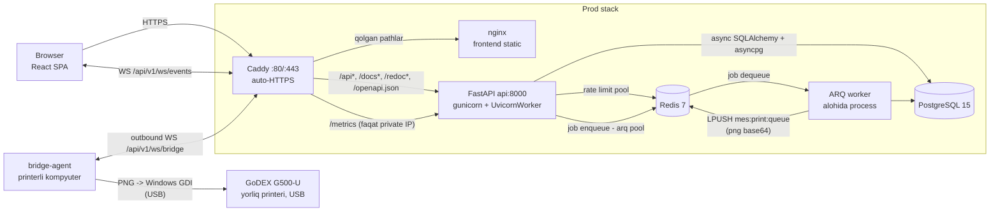

# MebeliX MES — Arxitektura Overview

## 1. Loyiha nima?

**MebeliX MES** — mebel ishlab chiqarishni boshqarish tizimi (Manufacturing Execution
System) uchun to'liq ishlaydigan fullstack ilova. FastAPI fullstack template
poydevorida (JWT + httpOnly cookie auth, users boshqaruvi) **to'liq MES domeni**
qurilgan: `/v1` agregatorida **17 ta router** (health, login, logout, users,
clients, employees, machines, posts, materials, orders, audit, terminal, scans,
tablo, reports, bridge-agents, ws), **17 ta ORM model**
(Order/Product/Part/PartInstance/PartRoute, Client, Employee, Machine, Post,
Material, Scan/WorkSession, AuditLog, BridgeAgent va h.k.) va
**12 ta `UserRole`** (admin, director, manager, texnolog, terminal, tablo + 6 ta
post operatori roli: arrachi, kromkachi, prisadkachi, pazchi, roverchi, stolyar).
Domen tafsilotlari uchun [09-mes-domain.md](./09-mes-domain.md) ga qarang.

Barcha UI matnlari va API xato xabarlari **o'zbek tilida**; telefon raqamlari
O'zbekiston E.164 formatida (`+998XXXXXXXXX`) validatsiya qilinadi.

Repo tuzilishi:

```
MebeliX-Mes-System/
├── backend/          # FastAPI ilova (app/api, app/core, app/models, app/services, app/assets, ...)
├── frontend/         # Vite + React SPA (src/routes, src/components, src/client, ...)
├── bridge-agent/     # Tsex agenti (agent.py) — print joblarni USB GoDEX printerga yuboradi
│                     #   (Windows drayveri orqali PNG; faqat printerli kompyuterda)
│                     #   mebelix-agent.exe bo'lib yig'iladi, panel kodi bilan ulanadi (pairing)
├── caddy/            # Caddy reverse proxy konfiguratsiyasi (prod)
├── scripts/          # setup.sh, prestart.sh, generate-client.sh, deploy.sh (TAG deploy + avto-rollback), backup.sh (kunlik shifrlangan DB backup)
├── docs/             # Ushbu hujjatlar to'plami
├── docker-compose.local.yml
├── docker-compose.prod.yml
└── Makefile          # Dev operatsiyalar kirish nuqtasi (prod deploy: CI + scripts/deploy.sh)
```

## 2. Texnologik stack

### Backend

| Qatlam | Texnologiya |
|---|---|
| Til / runtime | Python 3.11–3.13, uvloop |
| Web framework | FastAPI (async), uvicorn (dev) / gunicorn + UvicornWorker (prod) |
| ORM / DB driver | SQLAlchemy 2.0 (async, MappedAsDataclass) + asyncpg |
| Migratsiyalar | Alembic (async rejim, autogenerate) |
| Validatsiya / config | Pydantic v2 + pydantic-settings (`.env` → `Settings` singleton) |
| Auth | PyJWT (HS256 access/refresh), bcrypt, httpOnly cookies, `token_version` revocation |
| Background jobs | ARQ (Redis asosli queue, alohida worker process) |
| Yorliq renderi | Pillow (80×60 mm PNG chizish, 1-bit chiqish) + qrcode (QR) — `app/services/labels.py` |
| Rate limiting | Redis asosli, fail-closed (Redis yiqilsa so'rovlar bloklanadi — brute-force himoya o'chib qolmasligi uchun) |
| Observability | prometheus-fastapi-instrumentator (`/metrics`), JSON structured logging + X-Request-ID |
| Package manager | uv |

### Frontend

| Qatlam | Texnologiya |
|---|---|
| Build / til | Vite 8, React 19, TypeScript (strict) |
| Routing | TanStack Router (file-based, `routeTree.gen.ts` avtomatik) |
| Server state | TanStack Query (markazlashtirilgan query key'lar) |
| API client | `@hey-api/openapi-ts` — backend `openapi.json`dan avtomatik generatsiya |
| HTTP | Axios (401 → silent refresh interceptor) |
| Formalar / validatsiya | react-hook-form + zod |
| UI | Tailwind CSS v4 + shadcn/ui (Radix), MebeliX brend palitrasi (navy `#1c2b42` / gold `#f0a52f`) |
| Lint / format | Biome |

### Infra & DevOps

| Qatlam | Texnologiya |
|---|---|
| Konteynerlash | Docker Compose — `local` (hot-reload, portlar ochiq) va `prod` (faqat Caddy tashqariga ochiq) |
| Ma'lumotlar bazasi | PostgreSQL 15 |
| Cache / queue | Redis 7 (ARQ queue + rate limit, ikkita alohida pool) |
| Reverse proxy | Caddy (prod, `SITE_ADDRESS` orqali auto-HTTPS / Let's Encrypt); port bindinglar `CADDY_HTTP_BIND`/`CADDY_HTTPS_BIND` bilan parametrlangan — mavjud host-nginx (ISPmanager) ortida ishlash rejimi uchun |
| Static serving | nginx (frontend build, SPA fallback, 1 yillik asset cache) |
| Sifat nazorati | pre-commit hooks (ruff, mypy, biome) + GitHub Actions CI (`.github/workflows/ci.yml`) |
| Konfiguratsiya | Yagona `.env` fayl (JWT, DB/Redis, admin user, rate-limit, `GUNICORN_WORKERS`, `SITE_ADDRESS`); `BRIDGE_TOKEN` endi ixtiyoriy — printerlar admin paneldagi pairing bilan ulanadi |

## 3. High-level arxitektura



Asosiy nuqtalar:

- **Prod'da yagona kirish — Caddy**: `/api*`, `/docs*`, `/redoc*`,
  `/openapi.json` → `api:8000`, qolgan hamma narsa → `frontend:80` (nginx).
  `/metrics` faqat `private_ranges` IP'lardan o'tadi, tashqi so'rovlar 403 oladi.
  Alohida `:8080` listener `/healthz` beradi (Docker healthcheck uchun,
  auto-HTTPS redirect'dan mustaqil). Frontend nginx'i `/api` pathlarga ataylab
  404 qaytaradi — API'ga faqat Caddy orqali kiriladi.
- **Local dev'da Caddy yo'q**: uvicorn hot-reload bilan `localhost:8000`, Vite dev
  server alohida; `VITE_API_URL` build-arg local'da `http://localhost:8000`,
  prod'da `""` (bo'sh — SDK yo'llari allaqachon `/api/v1` bilan boshlanadi,
  so'rovlar same-origin, Caddy orqali). Ikkinchi build-arg: `VITE_API_TIMEOUT_MS`.
- **WebSocket qatlami** (`app/api/routes/ws.py`): `/api/v1/ws/events` — brauzer
  real-time kanali (JWT cookie yoki `?token=` bilan auth, rolga qarab
  terminal/tablo/dashboard scope, `ws_manager` fan-out); `/api/v1/ws/bridge` —
  bridge-agent uplink (per-agent token `Authorization: Bearer` headerda,
  `bridge_agent.token_hash` bo'yicha sha256 qidiruv; legacy umumiy `BRIDGE_TOKEN`
  `compare_digest` bilan hamon qabul qilinadi). Batafsil:
  [4.3](#43-yorliq-chop-etish-zanjiri).
- **Yorliq chop etish oqimi**: `print_label` ARQ task base64 PNG
  (`render_label_png`) ni Redis `mes:print:queue` ro'yxatiga qo'yadi →
  `/ws/bridge` uni printerli kompyuterdagi `bridge-agent/agent.py` ga uzatadi
  (agent lokal JSONL navbatga yozib ack qaytaradi — yorliq yo'qolmaydi) →
  Windows drayveri orqali USB GoDEX'ga chiqadi. G500-U'da tarmoq porti yo'q,
  shuning uchun yagona transport shu. Batafsil:
  [4.3](#43-yorliq-chop-etish-zanjiri).
- **Ikkita Redis pool**: biri ARQ job queue, biri rate limiting — ikkalasi ham
  startup'da retry'li probe bilan tekshiriladi (fail-fast boot); rate limit
  runtime'da ham fail-closed — Redis xatosida so'rov bloklanadi.
- **ARQ worker** alohida konteyner/processda ishlaydi (`app/core/worker.py` →
  `WorkerSettings`), tasklar `app/tasks/` da ro'yxatdan o'tadi.
- **Prod deploy TAG asosida**: prod image'lar TAG bilan parametrlangan
  (`mebelix-mes-backend/frontend:${TAG:-latest}`, `docker-compose.prod.yml`);
  `scripts/deploy.sh` yangi TAG'ni build/switch qiladi, smoke (`/api/v1/ready`)
  yiqilsa `.stable_tag`dagi oxirgi stable TAG'ga avto-rollback qiladi.
- Har konteyner startida `scripts/prestart.sh` **alembic migratsiya + birinchi
  superuser + default org/postlar seed** (`seed_defaults`) ni bajaradi.

## 4. Request lifecycle

### 4.1 Login flow

```
Browser                      FastAPI                        PostgreSQL/Redis
   |                            |                                 |
   |  POST /api/v1/login        |                                 |
   |  (username/telefon+parol)  |                                 |
   |--------------------------->|                                 |
   |                            |-- RateLimit dependency -------->| Redis: brute-force tekshiruv
   |                            |-- crud_users.authenticate ----->| DB: get_by_login
   |                            |   (bcrypt verify, threadpool)   | (username yoki +998... telefon)
   |                            |                                 |
   |  Set-Cookie:               |                                 |
   |   access_token (httpOnly)  |  JWT ichida token_version       |
   |   refresh_token (httpOnly) |  SameSite=Strict                |
   |<---------------------------|                                 |
```

- Tokenlar **hech qachon JS'ga berilmaydi** — faqat httpOnly cookie
  (`secure` flag non-local muhitlarda). `Authorization: Bearer` header ham qabul
  qilinadi va cookie'dan ustuvor.
- `login`/`refresh` har chaqiruvda **ikkala tokenni rotatsiya** qiladi.
- Logout DB'dagi `token_version`ni oshiradi — barcha eski tokenlar birdaniga 401
  oladi (mass-invalidation).

### 4.2 Authenticated request flow

```
Browser (React)                FastAPI                        PostgreSQL
   |                              |                               |
   | TanStack Query so'rovi       |                               |
   | (generatsiya qilingan        |                               |
   |  UsersService, cookie avto)  |                               |
   |----------------------------->|                               |
   |         ProxyHeadersMiddleware (real client IP) -> CORS ->   |
   |         RequestLoggingMiddleware (X-Request-ID, JSON log)    |
   |                              |                               |
   |                              |-- get_current_user dep ------>| JWT decode +
   |                              |   (CurrentUser/SuperUserDep)  | token_version tekshiruv
   |                              |-- route handler -> crud ----->| async session
   |<-----------------------------|                               |
   |                                                              |
   | 401 bo'lsa: Axios interceptor -> silent refresh -> retry     |
   | refresh ham yiqilsa: QueryCache tozalanadi -> /login redirect|
```

- Router ierarxiyasi: `/api` root → `/v1` agregator; auth **router darajasida**
  qo'llanadi (`health`, `login` ochiq; `logout`, `users` va 11 ta MES routeri
  `get_current_user` ortida; `ws` va `bridge-agents` routerlari auth'ni o'zlari
  hal qiladi — `bridge-agents` da `/pair` ochiq bo'lishi shart, admin
  endpointlar esa har biri `AdminUser` bilan himoyalangan).
- Frontend'da route guard'lar `beforeLoad`da `UsersService.readUserMe()` bilan
  ishlaydi: `_layout.tsx` himoyalangan sahifalarni qo'riqlaydi va rolga qarab
  yo'naltiradi — `terminal` va operator rollari (`arrachi`...`stolyar`) →
  `/terminal`, `tablo` → `/tablo` (qurilma/operator akkauntlari admin panelga
  kirmaydi); `login.tsx` teskari guard bilan sessiyali foydalanuvchini `/`ga
  qaytaradi.
- Parallel so'rovlarda 401 kelsa, interceptor ularni navbatga qo'yib bitta refresh
  bilan hal qiladi.
- `_layout.tsx` qobig'ida fon logotipi dekoratsiyasi alohida
  `absolute inset-0 overflow-hidden` konteynerga ko'chirilgan. Avval
  `overflow-hidden` `SidebarInset`ning o'zida edi va u ichki sahifalardagi
  `sticky` panellarni ishlamay qoldirardi.

### 4.3 Yorliq chop etish zanjiri

```
Terminal          FastAPI              ARQ worker          Redis        bridge-agent      GoDEX
   |                 |                     |                 |               |              |
   | POST /api/v1/terminal/labels/{instance_id}              |               |              |
   |---------------->|                     |                 |               |              |
   |                 | label_printed_at=now (DB)             |               |              |
   |                 | enqueue_job("print_label", id) ------>|               |              |
   |                 | ws_manager: "label.printed"           |               |              |
   |                 |                     |<----------------|               |              |
   |                 |                     | load_label_data(db, id)         |              |
   |                 |                     | render_label_png() -> base64    |              |
   |                 |                     | LPUSH mes:print:queue --------->|              |
   |                 |  /ws/bridge: brpop -> {"type","instance_id","png"} -->|              |
   |                 |<---------- ack {"ok": true} (agent diskka yozgach) ---|              |
   |                 |                     |                 |  JSONL -> flusher -> GDI --->|
```

- `POST /terminal/labels/{instance_id}` (`print_instance_label`,
  `app/api/routes/terminal.py`) — `PartInstance.label_printed_at` yoziladi, ARQ'ga
  `print_label` job qo'yiladi, `label.printed` WS eventi tarqatiladi.
- `app/tasks/__init__.py:print_label` yorliqni render qilib faqat Redis navbatiga
  qo'yadi. Job JSON: `{"type":"print","instance_id","png"}` →
  `LPUSH mes:print:queue`. Redis yo'q bo'lsa job `lost:` bilan yakunlanadi va
  xato log'ga yoziladi. Server printerga to'g'ridan-to'g'ri chiqmaydi — yagona
  yo'l bridge-agent.
- `/ws/bridge` (`app/api/routes/ws.py`) navbatni `brpop(timeout=5)` bilan so'radi;
  bo'sh bo'lsa `{"type":"ping"}` heartbeat yuboradi (yarim ochiq TCP tez o'lsin).
  Ack kelmasa yoki nak bo'lsa job `rpush` bilan navbatga qaytariladi — uzilishda
  yorliq yo'qolmaydi.
- bridge-agent job'ni AVVAL diskka (`print-queue.jsonl`) yozadi, keyin ack qaytaradi —
  server ackdan keyin jobni unutadi. `FLUSH_EVENT` bilan flusher darhol uyg'onadi
  (aks holda 5 s siklda printer tiklanishini kutadi).
- `send_to_printer()` da bitta chiqish yo'li bor: `_print_png_gdi()` — Windows
  drayveri (`win32ui` + `ImageWin.Dib`), DEVMODE'da qog'oz `DMPAPER_USER`
  80×60 mm ga majburlanadi. Admin huquqi ham, printer share ham talab qilmaydi.
  Printer xatosi `False` qaytaradi va job lokal navbatda qoladi.
- Printer AVTO-TOPILADI: `_detect_printer()` `win32print.EnumPrinters` ro'yxatidan
  nomida `godex` bor lokal printerni oladi — drayver o'rnatilsa bas, sozlash
  shart emas. `PRINTER_NAME` faqat qo'lda override uchun. Agent env'lari:
  `MES_URL`, `BRIDGE_TOKEN`, `PRINTER_NAME` (ixtiyoriy), `QUEUE_FILE`;
  `_load_dotenv()` ularni shu tartibda o'qiydi: env var > exe yonidagi `.env` >
  `%APPDATA%\MebelixAgent\.env`.
- Agent FAQAT printer ulangan kompyuterga o'rnatiladi (Windows Task Scheduler,
  "At startup"); menejer, texnolog va boshqa post terminallariga hech narsa
  kerak emas — ular brauzerdan tugmani bosadi.
- **Ulanish (pairing)** — har printer o'z tokeni bilan ishlaydi, serverda yagona
  umumiy token yo'q. Admin `/printers` sahifasida agent yaratadi va **8 belgili
  bir martalik kod** oladi (alifboda I/L/O/0/1 yo'q — telefonda aytganda
  adashtirmaydi; 15 daqiqa yashaydi). Tsex kompyuterida `mebelix-agent.exe`
  birinchi marta ishga tushganda (`_pair_interactive()`) server manzili va kodni
  so'raydi, `POST /bridge-agents/pair` orqali doimiy tokenga almashtiradi va uni
  `%APPDATA%\MebelixAgent\.env` ga yozadi. `BRIDGE_TOKEN` allaqachon berilgan
  bo'lsa yoki stdin tty bo'lmasa — so'ramaydi.
- `bridge_agent` jadvali (`app/models/bridge_agent.py`, migratsiya
  `d5e81a24c3b7`): `organization_id`, `name`, `token_hash` (tokenning sha256'i,
  unique — token o'zi faqat pair javobida bir marta ko'rinadi), `pair_code`,
  `pair_expires_at`, `last_seen_at`.
- `/bridge-agents` routeri (`app/api/routes/bridge_agents.py`): `GET /` ro'yxat,
  `POST /` yangi agent + kod, `POST /{id}/code` yangi kod (`token_hash` tozalanadi
  — eski kompyuter bekor bo'ladi), `DELETE /{id}` soft-delete — barchasi
  `AdminUser`. `POST /pair` OCHIQ: atomik `UPDATE ... RETURNING` bilan bitta kodni
  ikki kompyuter bir vaqtda ishlata olmaydi, xato esa yagona umumiy matn — kod
  bor-yo'qligi oshkor bo'lmaydi. `GET /download` `uploads/agent/mebelix-agent.exe`
  ni beradi.
- `/ws/bridge` tokenni `Authorization: Bearer` headerdan oladi (server
  access-loglariga tushmasin; `?token=` eski agentlar uchun fallback). Legacy
  `settings.BRIDGE_TOKEN` `compare_digest` bilan hamon qabul qilinadi; aks holda
  sha256 xesh `bridge_agent` da qidiriladi, topilmasa ulanish 4401 bilan yopiladi.
  `touch_agent()` har 300 s da `last_seen_at` ni yangilaydi va agent hali tirikligini
  qayta tekshiradi — bekor qilingan bo'lsa jonli ulanish ham uziladi (maks ~5 daqiqa
  kechikish) va qo'ldagi job navbatga qaytariladi.
- Tsex kompyuteriga Python ham, pip ham, SSH ham, serverdagi `.env` tahriri ham
  KERAK EMAS: agent PyInstaller onefile `mebelix-agent.exe` (~16 MB) bo'lib
  yig'iladi — admin uni paneldan yuklab oladi, ishga tushiradi va kodni yozadi.
  Frontend tomoni: `frontend/src/routes/_layout/printers.tsx` ("Printer agentlar")
  va sidebar yozuvi.
- `render_label_png()` (`app/services/labels.py`) — 80×60 mm, 203 dpi
  (8 dot/mm → 640×480 px). `draw.fontmode = "1"` (antialiasing yo'q) va yakuniy
  `convert("L").point(v < 160)` — chiqish sof 1-bit, drayver dither qilmasin.
  Maket: chap ustunda logo (`app/assets/label-logo.png`), `Formatka` + zakaz kodi,
  detal kodi, loyiha nomi, 2×2 kromka katakchalari (tagchiziqli), katta
  `L x W = count`, `N_nom`, XNC belgilari (`П` paz, `Ф` freza, teshik uchun
  `app/assets/label-icon-drill.png` ikonkasi), material va sana; o'ng ustunda QR
  (`qrcode`, `instance.qr_text`) va vertikal detal eskizi.
- Eskizda kromka konturdan 1 mm tashqarida qalin chiziq bilan, `part.txt` bo'lsa
  tekstura chiziqlari, va cutmap'dan HAQIQIY teshiklar: `load_label_data()`
  `order.cutmap["holes"][cell_id]` ni `part.label_num` bo'yicha topadi, `bores`
  aylana, `edge` esa qirradan ichkariga chiziqcha bo'lib chiziladi.
- `GET /terminal/labels/{instance_id}.png` (`render_instance_label`) o'sha PNG'ni
  brauzerga beradi — GoDEX bo'lmasa istalgan printerdan chop etish yo'li.

### 4.4 Buyurtma anketasi (mijoz so'rovnomasi + o'lchov varag'i)

Qog'oz anketa (`uploads/forma/mebel_buyurtma_anketa.html`, repo'da kuzatilmaydi)
o'rnini bosadi: menejer to'ldiradi, texnolog o'qib dizayn yasaydi.

- Saqlash: `PUT /api/v1/orders/{id}/survey` (`save_order_survey`, ManagerUser) —
  butun anketa bir butun sifatida `Order.survey` (JSONB, migratsiya
  `a91c7d34f6e2_order_survey.py`) ga yoziladi. `DELIVERED`/`CANCELLED` statusda
  403. Audit: `survey_saved`.
- Sxema `app/schemas/orders.py`: `OrderSurvey` (`version`, `measured_at`,
  `measured_by`, `rooms` ≤10) → `SurveyRoom` (mebel turlari, shakl, xona
  o'lchamlari, korpus/fasad materiali, stol usti, furnitura darajasi, qo'shimcha
  xizmatlar, izoh) → `walls` ≤8 (`SurveyWall`) va `modules` ≤40 (`SurveyModule`).
  Har bir mm maydoni `ge=0, le=50_000` bilan chegaralangan — bitta so'rov bazani
  to'ldirib yubormasin. `OrderDetail.survey` orqali o'qiladi.
- Variant kodlari (`ldsp`, `akril`, `led`…) bazada, matnlari faqat
  `frontend/src/lib/anketa.ts` da — katalog o'zgarsa saqlangan tarix buzilmaydi
  va migratsiya kerak emas.
- Xona rasmlari: `POST /orders/{id}/survey/photos` (`upload_room_photo`,
  multipart `room_id` + `file`) — JPG/PNG/WEBP, ≤5 MB, bitta xonaga ≤6 ta. Fayl
  `uploads/survey/{order_id}/{uuid}.ext` ga yoziladi va mavjud
  `OrderFile(kind=DOCUMENT, meta={"room_id","content_type"})` qatorida qayd
  etiladi — alohida jadval va migratsiya yo'q.
- `DELETE /orders/{id}/survey/photos/{file_id}` (`delete_room_photo`) diskdagi
  faylni ham o'chiradi. `save_order_survey` esa o'chirilgan xonalarning rasmlarini
  yetim qoldirmaydi: `meta["room_id"]` tirik xonalar ro'yxatida bo'lmagan
  `OrderFile` lar soft-delete qilinadi va diskdan `unlink` bo'ladi.
- `OrderFileRead` ga `meta` maydoni qo'shildi (frontend rasmlarni `room_id`
  bo'yicha ajratadi); `download_order_file` endi DOCUMENT uchun
  `meta["content_type"]` ni media type qilib qaytaradi — aks holda brauzer
  `` da ko'rsatish o'rniga faylni yuklab olardi.
- Frontend `frontend/src/routes/_layout/anketa.$orderId.tsx` (`/anketa/{orderId}`):
  xona tablari, 1.5 s debounce avtosaqlash, `beforeunload` ogohlantirish va
  unmount'da fire-and-forget saqlash. Server javobi FAQAT bir marta yuklanadi
  (`loaded` ref) — saqlashdan keyingi refetch menejer yozayotgan matn ustiga
  tushmasin. Admin/manager formani ko'radi, qolgan rollar `RoomSummary` jamlanmasini.
  Kirish nuqtasi — buyurtma kartasidagi "Anketa" tugmasi.
- Yangi UI primitivi: `frontend/src/components/ui/textarea.tsx`.

### 4.5 Arrachi terminali: kesish xaritasi

- `frontend/src/routes/terminal.tsx` — majburiy to'liq ekran overlay: to'liq
  ekranga o'tmaguncha ish boshlanmaydi. `requestFullscreen` user-gesture talab
  qilgani uchun tugma orqali; holat `document.fullscreenElement` VA
  `matchMedia("(display-mode: fullscreen)")` bo'yicha aniqlanadi, ya'ni
  `chrome --kiosk` / PWA rejimi ham to'liq ekran hisoblanadi.
- Kiosk avto-yangilanish: `index.html` ga davriy `HEAD` so'rov, `ETag` o'zgarsa
  `updateReady` belgilanadi va xavfsiz paytda (xarita yopiq, 2 daqiqa skan yo'q)
  sahifa o'zi reload bo'ladi. `import.meta.env.DEV` da o'chirilgan — Vite ETag'i
  o'zgaruvchan, dev'da reload sikli bo'lardi.
- `components/Terminal/CutmapView.tsx` — drill-down oqim: material tablari →
  list kartalari (har birida mini xarita preview) → to'liq ekran xarita. Chap
  toolbar: orqaga, listlar ro'yxati, zoom. Material statistikasi terminal
  header'iga portal qilinadi — xarita balandligidan joy olmaydi.
- `components/Terminal/SheetSvg.tsx` (yangi) — bitta listning to'liq SVG renderi:
  detallar, kesim chiziqlari, teshiklar (`holeXY`, `edgeLocalXY`, `edgeBoreRect`),
  o'lchamlar zanjiri, zoom/pan/swipe; `thumbnail` rejimida interaktivsiz va
  scrollni bloklamaydi. Xarita ham, list kartalaridagi preview ham shu bitta
  komponentni ishlatadi.
- `GET /terminal/orders` javobi karta uchun kengaydi: `materials` (`sheet` turidagi
  plita nomlari), `sheets_total`, `has_cutmap`. Tartib — prioritet (URGENT birinchi)
  → `deadline` (nulls oxirida) → `id`; boshqa stanokka biriktirilgan `PartRoute`lar
  bu terminalda ko'rinmaydi (`/tasks` bilan bir xil filtr).

## 5. Hujjatlar xaritasi

| Hujjat | Mazmuni |
|---|---|
| [02-backend-core.md](./02-backend-core.md) | FastAPI yadro qatlami: `create_application()` factory, `Settings` singleton, lifespan probe'lari (DB + 2×Redis), middleware stack, JWT/bcrypt xavfsizlik, env-shartli docs siyosati, ARQ worker sozlamalari. |
| [03-backend-api.md](./03-backend-api.md) | REST endpointlar: ikki bosqichli router ierarxiyasi, login/logout/refresh (one-time-use rotatsiya) va `token_version` revocation, `users` moduli, health/readiness problar, rate limiting. |
| [04-backend-data.md](./04-backend-data.md) | Data layer: `BaseModel` (ID/Timestamp/SoftDelete mixin'lar), generic `BaseCRUD`, rolga qarab ajratilgan Pydantic schemalar, Alembic async migratsiyalar, `create_first_superuser` bootstrap, ARQ task infratuzilmasi. |
| [05-frontend-app.md](./05-frontend-app.md) | SPA arxitekturasi: TanStack Router file-based routing, TanStack Query, cookie-auth + silent refresh interceptor, OpenAPI'dan generatsiya qilingan client, zod validatsiya, route guard'lar. |
| [06-frontend-components.md](./06-frontend-components.md) | Prezentatsiya qatlami: Admin CRUD dialoglari, Common (DataTable, ConfirmDialog), rolga qarab Sidebar navigatsiya, UserSettings, custom shadcn/ui primitivlar (sidebar, loading-button, password-input). |
| [07-infra-devops.md](./07-infra-devops.md) | Infra: local/prod Docker Compose stacklar, Caddy auto-HTTPS routing, multi-stage Dockerfile'lar (uv / node→nginx), prestart migratsiyalar, Makefile targetlar, pre-commit hooks. |
| [08-packages.md](./08-packages.md) | Dependency snapshot: backend/frontend paket versiyalari va ataylab ushlab qolingan ceiling'lar (redis, openapi-ts, typescript). |
| [09-mes-domain.md](./09-mes-domain.md) | MES domeni: data model, GibLab parser, scan engine, cutmap, chop etish, terminal/tablo/reports API va frontend tuzilishi. |

## 6. Kod yozish konventsiyalari

Sifat nazorati ikki qatlamda: **pre-commit hooks** (`.pre-commit-config.yaml`,
`make install-hooks` bilan o'rnatiladi) va **GitHub Actions CI**
(`.github/workflows/ci.yml`, `main`ga push va har PR'da): `backend` job — ruff
check/format, mypy, GibLab parser testlari; `frontend` job — `biome ci` va
`tsc + vite build`; `deploy` job — yashil `main` push'da kod
`/opt/mebelix-mes`ga rsync qilinadi, `TAG=<git sha> scripts/deploy.sh`
ishga tushadi va public smoke (`https://mes.mebelix.uz/api/v1/ready`)
tekshiriladi; `notify` job — Telegram xabari. Notify ataylab ALOHIDA job
(`if: always()`, `needs: [backend, frontend, deploy]`): `deploy` ichida turganda
CI yiqilsa butun job skip bo'lib, xabar umuman ketmasdi. Endi `deploy` natijasi
`skipped` bo'lsa ham xabar ketadi va qaysi job yiqilgani ko'rsatiladi.

### Backend (Python)

- **ruff** — lint + format (`target-version = py311`, `line-length = 120`;
  qoidalar: Pyflakes, pycodestyle, mccabe/comprehensions, pyupgrade, isort).
  Pre-commit'da `ruff --fix` va `ruff-format` avtomatik ishlaydi.
- **mypy** — `app.*` modullari uchun `disallow_untyped_defs = true`, ya'ni barcha
  funksiyalar to'liq type-annotated bo'lishi shart. Local hook sifatida
  `uv --directory backend run mypy app` bilan ishlaydi.
- Package manager — **uv**; barcha buyruqlar `uv --project backend run ...`
  orqali.

### Frontend (TypeScript)

- **Biome** — lint + format (`npm run lint`, pre-commit'da `biome check`);
  generatsiya qilingan fayllar (`src/client/`, `routeTree.gen.ts`) tekshiruvdan
  chiqarilgan.
- TypeScript **strict** rejimda; `src/client/` qo'lda tahrirlanmaydi — faqat
  `make frontend-gen` (`scripts/generate-client.sh`) bilan qayta generatsiya
  qilinadi.
- zod schemalar (`src/lib/validation.ts`) backend `schemas/users.py`
  cheklovlariga (parol min 8, `^\+998\d{9}$`) qo'lda sinxron ushlab turiladi —
  backend validatsiya o'zgartirilsa, frontend zod schemasini ham yangilash kerak.

### Umumiy

- pre-commit sanitariya hooklari: `check-added-large-files`, `check-toml`,
  `check-yaml`.
- Kundalik operatsiyalar uchun **Makefile** yagona kirish nuqtasi: `make help`
  barcha targetlarni ko'rsatadi (`setup`, `run-backend`, `worker`,
  `run-frontend`, `lint`, `format`, `migrate`, `makemigrations`,
  `frontend-gen`, `docker-local`, `docker-prod`).
- Foydalanuvchiga ko'rinadigan barcha matnlar (UI, API xatolari) — o'zbek tilida;
  kod, identifikatorlar va commit'lar — inglizcha.
