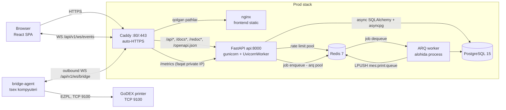

# MebeliX MES — Arxitektura Overview

## 1. Loyiha nima?

**MebeliX MES** — mebel ishlab chiqarishni boshqarish tizimi (Manufacturing Execution
System) uchun to'liq ishlaydigan fullstack ilova. FastAPI fullstack template
poydevorida (JWT + httpOnly cookie auth, users boshqaruvi) **to'liq MES domeni**
qurilgan: `/v1` agregatorida **16 ta router** (health, login, logout, users,
clients, employees, machines, posts, materials, orders, audit, terminal, scans,
tablo, reports, ws), **16 ta ORM model** (Order/Product/Part/PartInstance/PartRoute,
Client, Employee, Machine, Post, Material, Scan/WorkSession, AuditLog va h.k.) va
**12 ta `UserRole`** (admin, director, manager, texnolog, terminal, tablo + 6 ta
post operatori roli: arrachi, kromkachi, prisadkachi, pazchi, roverchi, stolyar).
Domen tafsilotlari uchun [09-mes-domain.md](./09-mes-domain.md) ga qarang.

Barcha UI matnlari va API xato xabarlari **o'zbek tilida**; telefon raqamlari
O'zbekiston E.164 formatida (`+998XXXXXXXXX`) validatsiya qilinadi.

Repo tuzilishi:

```
MebeliX-Mes-System/
├── backend/          # FastAPI ilova (app/api, app/core, app/models, ...)
├── frontend/         # Vite + React SPA (src/routes, src/components, src/client, ...)
├── bridge-agent/     # Tsex agenti (agent.py) — print joblarni GoDEX printerga yuboradi
├── caddy/            # Caddy reverse proxy konfiguratsiyasi (prod)
├── scripts/          # setup.sh, prestart.sh, generate-client.sh, deploy.sh (TAG deploy + avto-rollback), backup.sh (kunlik shifrlangan DB backup)
├── docs/             # Ushbu hujjatlar to'plami
├── docker-compose.local.yml
├── docker-compose.prod.yml
└── Makefile          # Dev operatsiyalar kirish nuqtasi (prod deploy: CI + scripts/deploy.sh)
```

## 2. Texnologik stack

### Backend

| Qatlam | Texnologiya |
|---|---|
| Til / runtime | Python 3.11–3.13, uvloop |
| Web framework | FastAPI (async), uvicorn (dev) / gunicorn + UvicornWorker (prod) |
| ORM / DB driver | SQLAlchemy 2.0 (async, MappedAsDataclass) + asyncpg |
| Migratsiyalar | Alembic (async rejim, autogenerate) |
| Validatsiya / config | Pydantic v2 + pydantic-settings (`.env` → `Settings` singleton) |
| Auth | PyJWT (HS256 access/refresh), bcrypt, httpOnly cookies, `token_version` revocation |
| Background jobs | ARQ (Redis asosli queue, alohida worker process) |
| Rate limiting | Redis asosli, fail-closed (Redis yiqilsa so'rovlar bloklanadi — brute-force himoya o'chib qolmasligi uchun) |
| Observability | prometheus-fastapi-instrumentator (`/metrics`), JSON structured logging + X-Request-ID |
| Package manager | uv |

### Frontend

| Qatlam | Texnologiya |
|---|---|
| Build / til | Vite 8, React 19, TypeScript (strict) |
| Routing | TanStack Router (file-based, `routeTree.gen.ts` avtomatik) |
| Server state | TanStack Query (markazlashtirilgan query key'lar) |
| API client | `@hey-api/openapi-ts` — backend `openapi.json`dan avtomatik generatsiya |
| HTTP | Axios (401 → silent refresh interceptor) |
| Formalar / validatsiya | react-hook-form + zod |
| UI | Tailwind CSS v4 + shadcn/ui (Radix), MebeliX brend palitrasi (navy `#1c2b42` / gold `#f0a52f`) |
| Lint / format | Biome |

### Infra & DevOps

| Qatlam | Texnologiya |
|---|---|
| Konteynerlash | Docker Compose — `local` (hot-reload, portlar ochiq) va `prod` (faqat Caddy tashqariga ochiq) |
| Ma'lumotlar bazasi | PostgreSQL 15 |
| Cache / queue | Redis 7 (ARQ queue + rate limit, ikkita alohida pool) |
| Reverse proxy | Caddy (prod, `SITE_ADDRESS` orqali auto-HTTPS / Let's Encrypt); port bindinglar `CADDY_HTTP_BIND`/`CADDY_HTTPS_BIND` bilan parametrlangan — mavjud host-nginx (ISPmanager) ortida ishlash rejimi uchun |
| Static serving | nginx (frontend build, SPA fallback, 1 yillik asset cache) |
| Sifat nazorati | pre-commit hooks (ruff, mypy, biome) + GitHub Actions CI (`.github/workflows/ci.yml`) |
| Konfiguratsiya | Yagona `.env` fayl (JWT, DB/Redis, admin user, rate-limit, `GUNICORN_WORKERS`, `SITE_ADDRESS`, printing: `PRINTER_IP`/`PRINTER_PORT`/`BRIDGE_TOKEN`) |

## 3. High-level arxitektura



Asosiy nuqtalar:

- **Prod'da yagona kirish — Caddy**: `/api*`, `/docs*`, `/redoc*`,
  `/openapi.json` → `api:8000`, qolgan hamma narsa → `frontend:80` (nginx).
  `/metrics` faqat `private_ranges` IP'lardan o'tadi, tashqi so'rovlar 403 oladi.
  Alohida `:8080` listener `/healthz` beradi (Docker healthcheck uchun,
  auto-HTTPS redirect'dan mustaqil). Frontend nginx'i `/api` pathlarga ataylab
  404 qaytaradi — API'ga faqat Caddy orqali kiriladi.
- **Local dev'da Caddy yo'q**: uvicorn hot-reload bilan `localhost:8000`, Vite dev
  server alohida; `VITE_API_URL` build-arg local'da `http://localhost:8000`,
  prod'da `""` (bo'sh — SDK yo'llari allaqachon `/api/v1` bilan boshlanadi,
  so'rovlar same-origin, Caddy orqali). Ikkinchi build-arg: `VITE_API_TIMEOUT_MS`.
- **WebSocket qatlami** (`app/api/routes/ws.py`): `/api/v1/ws/events` — brauzer
  real-time kanali (JWT cookie yoki `?token=` bilan auth, rolga qarab
  terminal/tablo/dashboard scope, `ws_manager` fan-out); `/api/v1/ws/bridge` —
  bridge-agent uplink (`BRIDGE_TOKEN` bilan auth, `compare_digest`).
- **Yorliq chop etish oqimi**: `print_label` ARQ task EZPL yorliqni Redis
  `mes:print:queue` ro'yxatiga qo'yadi → `/ws/bridge` uni tsexdagi
  `bridge-agent/agent.py` ga uzatadi (agent lokal JSONL navbatga yozib ack
  qaytaradi — yorliq yo'qolmaydi) → GoDEX printerga TCP 9100 (cp1251).
  `PRINTER_IP` sozlansa server to'g'ridan-to'g'ri TCP yuboradi.
- **Ikkita Redis pool**: biri ARQ job queue, biri rate limiting — ikkalasi ham
  startup'da retry'li probe bilan tekshiriladi (fail-fast boot); rate limit
  runtime'da ham fail-closed — Redis xatosida so'rov bloklanadi.
- **ARQ worker** alohida konteyner/processda ishlaydi (`app/core/worker.py` →
  `WorkerSettings`), tasklar `app/tasks/` da ro'yxatdan o'tadi.
- **Prod deploy TAG asosida**: prod image'lar TAG bilan parametrlangan
  (`mebelix-mes-backend/frontend:${TAG:-latest}`, `docker-compose.prod.yml`);
  `scripts/deploy.sh` yangi TAG'ni build/switch qiladi, smoke (`/api/v1/ready`)
  yiqilsa `.stable_tag`dagi oxirgi stable TAG'ga avto-rollback qiladi.
- Har konteyner startida `scripts/prestart.sh` **alembic migratsiya + birinchi
  superuser + default org/postlar seed** (`seed_defaults`) ni bajaradi.

## 4. Request lifecycle

### 4.1 Login flow

```
Browser                      FastAPI                        PostgreSQL/Redis
   |                            |                                 |
   |  POST /api/v1/login        |                                 |
   |  (username/telefon+parol)  |                                 |
   |--------------------------->|                                 |
   |                            |-- RateLimit dependency -------->| Redis: brute-force tekshiruv
   |                            |-- crud_users.authenticate ----->| DB: get_by_login
   |                            |   (bcrypt verify, threadpool)   | (username yoki +998... telefon)
   |                            |                                 |
   |  Set-Cookie:               |                                 |
   |   access_token (httpOnly)  |  JWT ichida token_version       |
   |   refresh_token (httpOnly) |  SameSite=Strict                |
   |<---------------------------|                                 |
```

- Tokenlar **hech qachon JS'ga berilmaydi** — faqat httpOnly cookie
  (`secure` flag non-local muhitlarda). `Authorization: Bearer` header ham qabul
  qilinadi va cookie'dan ustuvor.
- `login`/`refresh` har chaqiruvda **ikkala tokenni rotatsiya** qiladi.
- Logout DB'dagi `token_version`ni oshiradi — barcha eski tokenlar birdaniga 401
  oladi (mass-invalidation).

### 4.2 Authenticated request flow

```
Browser (React)                FastAPI                        PostgreSQL
   |                              |                               |
   | TanStack Query so'rovi       |                               |
   | (generatsiya qilingan        |                               |
   |  UsersService, cookie avto)  |                               |
   |----------------------------->|                               |
   |         ProxyHeadersMiddleware (real client IP) -> CORS ->   |
   |         RequestLoggingMiddleware (X-Request-ID, JSON log)    |
   |                              |                               |
   |                              |-- get_current_user dep ------>| JWT decode +
   |                              |   (CurrentUser/SuperUserDep)  | token_version tekshiruv
   |                              |-- route handler -> crud ----->| async session
   |<-----------------------------|                               |
   |                                                              |
   | 401 bo'lsa: Axios interceptor -> silent refresh -> retry     |
   | refresh ham yiqilsa: QueryCache tozalanadi -> /login redirect|
```

- Router ierarxiyasi: `/api` root → `/v1` agregator; auth **router darajasida**
  qo'llanadi (`health`, `login` ochiq; `logout`, `users` va 11 ta MES routeri
  `get_current_user` ortida; `ws` router auth'ni endpoint ichida o'zi hal qiladi).
- Frontend'da route guard'lar `beforeLoad`da `UsersService.readUserMe()` bilan
  ishlaydi: `_layout.tsx` himoyalangan sahifalarni qo'riqlaydi va rolga qarab
  yo'naltiradi — `terminal` va operator rollari (`arrachi`...`stolyar`) →
  `/terminal`, `tablo` → `/tablo` (qurilma/operator akkauntlari admin panelga
  kirmaydi); `login.tsx` teskari guard bilan sessiyali foydalanuvchini `/`ga
  qaytaradi.
- Parallel so'rovlarda 401 kelsa, interceptor ularni navbatga qo'yib bitta refresh
  bilan hal qiladi.

## 5. Hujjatlar xaritasi

| Hujjat | Mazmuni |
|---|---|
| [02-backend-core.md](./02-backend-core.md) | FastAPI yadro qatlami: `create_application()` factory, `Settings` singleton, lifespan probe'lari (DB + 2×Redis), middleware stack, JWT/bcrypt xavfsizlik, env-shartli docs siyosati, ARQ worker sozlamalari. |
| [03-backend-api.md](./03-backend-api.md) | REST endpointlar: ikki bosqichli router ierarxiyasi, login/logout/refresh (one-time-use rotatsiya) va `token_version` revocation, `users` moduli, health/readiness problar, rate limiting. |
| [04-backend-data.md](./04-backend-data.md) | Data layer: `BaseModel` (ID/Timestamp/SoftDelete mixin'lar), generic `BaseCRUD`, rolga qarab ajratilgan Pydantic schemalar, Alembic async migratsiyalar, `create_first_superuser` bootstrap, ARQ task infratuzilmasi. |
| [05-frontend-app.md](./05-frontend-app.md) | SPA arxitekturasi: TanStack Router file-based routing, TanStack Query, cookie-auth + silent refresh interceptor, OpenAPI'dan generatsiya qilingan client, zod validatsiya, route guard'lar. |
| [06-frontend-components.md](./06-frontend-components.md) | Prezentatsiya qatlami: Admin CRUD dialoglari, Common (DataTable, ConfirmDialog), rolga qarab Sidebar navigatsiya, UserSettings, custom shadcn/ui primitivlar (sidebar, loading-button, password-input). |
| [07-infra-devops.md](./07-infra-devops.md) | Infra: local/prod Docker Compose stacklar, Caddy auto-HTTPS routing, multi-stage Dockerfile'lar (uv / node→nginx), prestart migratsiyalar, Makefile targetlar, pre-commit hooks. |
| [08-packages.md](./08-packages.md) | Dependency snapshot: backend/frontend paket versiyalari va ataylab ushlab qolingan ceiling'lar (redis, openapi-ts, typescript). |
| [09-mes-domain.md](./09-mes-domain.md) | MES domeni: data model, GibLab parser, scan engine, cutmap, chop etish, terminal/tablo/reports API va frontend tuzilishi. |

## 6. Kod yozish konventsiyalari

Sifat nazorati ikki qatlamda: **pre-commit hooks** (`.pre-commit-config.yaml`,
`make install-hooks` bilan o'rnatiladi) va **GitHub Actions CI**
(`.github/workflows/ci.yml`, `main`ga push va har PR'da): `backend` job — ruff
check/format, mypy, GibLab parser testlari; `frontend` job — `biome ci` va
`tsc + vite build`; `deploy` job — yashil `main` push'da kod
`/opt/mebelix-mes`ga rsync qilinadi, `TAG=<git sha> scripts/deploy.sh`
ishga tushadi, public smoke (`https://mes.mebelix.uz/api/v1/ready`)
tekshiriladi va natija Telegram'ga yuboriladi.

### Backend (Python)

- **ruff** — lint + format (`target-version = py311`, `line-length = 120`;
  qoidalar: Pyflakes, pycodestyle, mccabe/comprehensions, pyupgrade, isort).
  Pre-commit'da `ruff --fix` va `ruff-format` avtomatik ishlaydi.
- **mypy** — `app.*` modullari uchun `disallow_untyped_defs = true`, ya'ni barcha
  funksiyalar to'liq type-annotated bo'lishi shart. Local hook sifatida
  `uv --directory backend run mypy app` bilan ishlaydi.
- Package manager — **uv**; barcha buyruqlar `uv --project backend run ...`
  orqali.

### Frontend (TypeScript)

- **Biome** — lint + format (`npm run lint`, pre-commit'da `biome check`);
  generatsiya qilingan fayllar (`src/client/`, `routeTree.gen.ts`) tekshiruvdan
  chiqarilgan.
- TypeScript **strict** rejimda; `src/client/` qo'lda tahrirlanmaydi — faqat
  `make frontend-gen` (`scripts/generate-client.sh`) bilan qayta generatsiya
  qilinadi.
- zod schemalar (`src/lib/validation.ts`) backend `schemas/users.py`
  cheklovlariga (parol min 8, `^\+998\d{9}$`) qo'lda sinxron ushlab turiladi —
  backend validatsiya o'zgartirilsa, frontend zod schemasini ham yangilash kerak.

### Umumiy

- pre-commit sanitariya hooklari: `check-added-large-files`, `check-toml`,
  `check-yaml`.
- Kundalik operatsiyalar uchun **Makefile** yagona kirish nuqtasi: `make help`
  barcha targetlarni ko'rsatadi (`setup`, `run-backend`, `worker`,
  `run-frontend`, `lint`, `format`, `migrate`, `makemigrations`,
  `frontend-gen`, `docker-local`, `docker-prod`).
- Foydalanuvchiga ko'rinadigan barcha matnlar (UI, API xatolari) — o'zbek tilida;
  kod, identifikatorlar va commit'lar — inglizcha.
